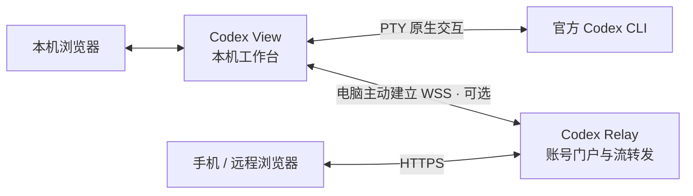

# Codex View & Codex Relay

本仓库（Codex Local Gateway）提供两个可独立构建、部署的组件：**Codex View** 是运行在用户电脑上的原生 Codex 工作台，**Codex Relay** 是可选的公网中继。View 可单独使用；需要从手机或其他设备远程访问时，再部署并连接 Relay。

## Codex View：本地工作台

在项目目录启动普通官方 Codex CLI，通过网页操作同一个原生终端，并阅读对话、工具结果和历史。官方 CLI 保持原版，输入、审批和模型设置仍由它负责。

- **终端与实时阅读**：保留原生 CLI 交互，同时展示流式回复、工具调用、上下文与用量。
- **项目与历史**：管理多个活动项目，浏览、搜索跨来源历史，明确选择可恢复的原生会话继续工作。
- **文件与 Git**：只读浏览项目文件、搜索代码、查看 Diff 和提交记录。
- **本地优先**：异步保存阅读记录，保存异常不阻断 CLI；默认仅本机访问，可显式开启局域网配对或公网连接。

日常入口是 `code-view`，底层程序为 `codex-view`；`codex-observerd` 仅保留旧 Observer 历史兼容能力。

[使用指南](docs/guides/usage.md) · [本机部署](docs/guides/local-workbench-deployment.md) · [架构](docs/architecture/workbench.md)

## Codex Relay：公网中继

部署在可信服务器上，为同一账号下的多台电脑提供统一 HTTPS 门户。电脑主动建立出站连接，无需将本机工作台端口直接暴露到公网。

- **账号与电脑管理**：登录、电脑登记与授权，以及由管理员维护普通用户账号。
- **统一远程入口**：手机或浏览器选择自己的在线电脑，访问其工作台、历史、项目和原生终端。
- **受限流转发**：提供经过身份校验的 HTTP、SSE 和终端 WebSocket 转发，不是通用网络代理。
- **独立运行**：程序为 `codex-relayd`，不运行 Codex CLI、模型代理或本机历史服务，不保存工作台历史正文。

Relay 提供可信中央前端；浏览器与电脑按 CLI Run 建立加密通道，后端只转发业务密文。运营者仍属可信方，恶意修改前端或授权不在防护范围内。远程访问需要电脑在线且三端版本兼容，见 [ADR 0066](docs/decisions/0066-run-scoped-encrypted-relay-channels.md)。

[中继部署与运维](docs/guides/public-relay-deployment.md) · [架构](docs/architecture/relay.md) · [交互与 API](docs/interactions/relay.md)

## 架构概览



View 负责本机 CLI、模型代理、实时观察和异步历史；Relay 只负责远程接入。两端仅共享协议与内嵌网页资源，不互相依赖对方的运行模块；电脑连接器仍属于 View。模型请求由电脑端直连配置的上游，不经 Relay。

更细的模块、数据和安全边界见[本机架构](docs/architecture/workbench.md)、[中继架构](docs/architecture/relay.md)；分端构建与部署见[组件指南](docs/guides/component-deployment.md)。

## 快速开始与支持范围

先按[安装指南](docs/guides/installation.md#快速安装与-path)安装本机组件，并自行安装、配置官方 Codex CLI：

```sh
cd /path/to/project
code-view       # 在当前项目启动 CLI 与网页工作台
codex-view      # 仅打开项目 / 历史首页，不启动 CLI
```

`v1.0.2` 发布包面向 macOS / Apple Silicon，包含后台服务与按 Run 加密的可选公网连接器，不附带独立 Relay 服务器；公网前端、电脑与 Relay 须配套使用 API/wire 3，无明文回退，仍信任自部署前端及授权方。模型路由、认证方式、CLI 版本和其他平台的受测边界见[支持范围](docs/guides/support.md)，主版本号不扩大受测范围。

从源码运行或部署 Relay，请分别阅读[开发指南](docs/development/README.md)和[中继部署指南](docs/guides/public-relay-deployment.md)。安装、后台运行、配置与卸载的完整步骤均在 `docs/guides/`。

## 仓库目录

```text
.
├── src/                      # View 后端与旧 Observer 兼容实现
│   ├── bin/codex-view.rs     # 本机工作台入口
│   ├── workbench/           # CLI / PTY、代理、观察、记录及电脑连接器
│   ├── history/             # 跨来源历史目录与只读查询
│   └── main.rs              # 旧 codex-observerd 入口
├── relay/                    # Relay 独立服务：账号、门户、授权与隧道
├── crates/                   # 两端共享的协议与静态网页资源
├── web/                      # 工作台前端、单元测试与浏览器测试
├── docs/                     # 使用、架构、设计和工程文档
│   ├── guides/              # 安装、使用、分端部署与支持范围
│   ├── architecture/        # 组件架构、数据与安全边界
│   ├── interactions/        # 页面流程与 API 契约
│   ├── configuration/       # 配置示例与 JSON Schema
│   ├── design/              # 产品方案、详细设计与专题契约
│   ├── decisions/           # 架构决策记录（ADR）
│   ├── development/         # 工具链、检查、调试与发布
│   └── references/          # 外部实现研究
├── scripts/                  # 统一开发入口、安装与发布工具
├── deploy/                   # Relay 的 TLS / systemd 部署模板
├── tests/                    # Rust 集成与契约测试
├── fixtures/                 # 合成测试数据
├── examples/                 # 合成调试程序
├── compatibility/            # Codex 兼容能力清单
├── migrations/               # 旧 Observer 数据库迁移
├── vendor/                   # 带原许可与修改说明的补丁依赖
└── .github/                  # CI 与协作模板
```

源码与部署模板保留在各自目录；详细操作和技术说明统一从 [docs 文档总索引](docs/README.md)进入。根目录只保留项目介绍、执行规范、贡献、安全、变更及许可等仓库级文档。

## 文档与参与

[文档总索引](docs/README.md) · [贡献指南](CONTRIBUTING.md) · [执行规范](AGENTS.md) · [安全报告](SECURITY.md) · [变更日志](CHANGELOG.md) · [第三方许可](THIRD_PARTY_NOTICES.md)

项目使用 [MIT 许可证](LICENSE)。
