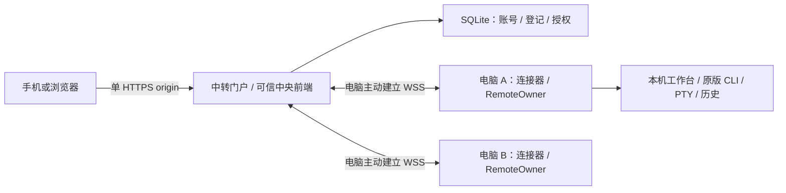

# 公网中转架构与维护契约

[文档总索引](../README.md) · [交互与 API](../interactions/relay.md) · [部署运维](../guides/public-relay-deployment.md) · [本机架构](workbench.md)

本文说明当前服务器组件的职责、依赖、身份、数据与安全不变量；操作顺序和接口见交互文档。决策依据为 [ADR 0056](../decisions/0056-public-workbench-relay.md)、[0058](../decisions/0058-admin-accounts-single-origin-relay.md)、[0059](../decisions/0059-workbench-routes-and-relay-recovery.md)、[0061](../decisions/0061-account-deletion-admin-rename.md)、[0062](../decisions/0062-independent-component-builds.md)。阶段状态只在 [V2 实施计划](../v2-implementation-plan.md)维护，验收事实见[验证索引](../validation/README.md)。

## 1. 职责、部署单元与非目标

`relay/` 是独立 Cargo package `codex-relayd`，仅产出中转 binary。服务器负责账号门户、电脑归属、可信中央前端及有界 HTTP/SSE/终端转发；不运行官方 Codex CLI、PTY、模型代理或本机历史。电脑上的后端仍是 `codex-local-observer` 的 `codex-view`，出站连接器位于 `src/workbench/relay`，不是服务器组件。

两个组件正常/构建依赖只共享 `crates/relay-protocol` 和 `crates/workbench-assets`，共享包不得反向依赖任一运行模块。本机的 relay dev-dependency 只用于跨端测试，不是生产依赖。

账号授予自有电脑完整 V2 工作台权限：原生终端、文件/搜索/Git 阅读、历史、项目启动与设置。非目标：项目共享、只读角色、离线电脑访问、V3 IM、任意 TCP/URL 代理、服务器 OS 登录和端到端加密。运营者是可信方，可读取并控制经过中转的内容。中转账号不等于本机 OS 沙箱；需要隔离本机历史时必须分别配置 OS 用户、工作台根、`CODEX_HOME`、历史数据及来源。

## 2. 源码责任地图

| 入口 | 责任与修改注意点 |
| --- | --- |
| [relay/src/main.rs](../../relay/src/main.rs) | CLI 参数、首次管理员初始化、离线恢复、服务启动；密码只从私有文件读取 |
| [relay/src/lib.rs](../../relay/src/lib.rs) | 配置与三种路由模式、精确 Host/Origin、安全响应头、路由、限流及主动撤销 |
| [relay/src/auth.rs](../../relay/src/auth.rs) | Argon2id、登录、改密、账号信息、退出；异步哈希结束后重查认证代际 |
| [relay/src/admin.rs](../../relay/src/admin.rs) | 普通用户列表、创建、重置、禁用/启用、删除；事务受理点重查管理员身份 |
| [relay/src/store.rs](../../relay/src/store.rs) | 私有目录/数据库、schema 迁移、会话/凭据验证、全端撤销、审计与清理 |
| [relay/src/portal.rs](../../relay/src/portal.rs) | 设备码批准与恢复登记、自有电脑列表、页面授权、历史一次性交换 |
| [relay/src/routing.rs](../../relay/src/routing.rs) | 中央静态页面、canonical `/g/` 路径、固定 grant selector 与父会话校验 |
| [relay/src/tunnel.rs](../../relay/src/tunnel.rs) | 控制/数据 WSS、续租、流预算、HTTP/SSE/终端桥接、响应过滤与取消 |
| [relay/static](../../relay/static) | 可信门户 HTML/JS/CSS；不得把电脑数据作为 HTML 插入 |
| [crates/relay-protocol/src/lib.rs](../../crates/relay-protocol/src/lib.rs) | wire 版本、工作台 API 版本、接口/页面白名单及预算常量 |
| [crates/workbench-assets](../../crates/workbench-assets) | 两端嵌入同一工作台前端、资源存在性与时效门禁 |
| [src/workbench/remote_access.rs](../../src/workbench/remote_access.rs)、[连接器](../../src/workbench/relay) | 本机 RemoteOwner 许可、私有 ingress、凭据保存与重连；变更须联动本机维护文档 |
| [web/src/workbench/context.ts](../../web/src/workbench/context.ts)、[routes.ts](../../web/src/workbench/routes.ts) | 固定页面身份、地址构造、导航和浏览器恢复隔离 |

## 3. 身份与授权模型

| 标识 | 生命周期与含义 |
| --- | --- |
| `accountId` / `auth_generation` | UUID 是账号身份；改密/重置/禁用/恢复管理员提升代际，旧凭据不能复活 |
| 门户父 `session` | HttpOnly Cookie 对应登录会话，最长 12 小时；临时密码会话受限 |
| `gatewayId` / 电脑凭据 | 安装实例的持久登记和独立 secret，非硬件指纹；服务端只保存哈希及授权代际 |
| 页面 grant | 子会话，固定关联原父会话、账号代际、电脑、UI/API 版本；不是仅凭 ID 可用的 bearer |
| `instanceId` | 每次工作台应用进程身份；不同于持久电脑登记 |
| `runId` / `runEpoch` | 本机项目运行及其终端/观察上下文，不能在重连时跨运行复用 |
| `connectionEpoch` / `streamId` | 一次中转连接及逻辑业务流，迟到旧连接数据不能附着新连接 |

“电脑”沿用安装实例，不采集硬件指纹。原登记恢复同时要求旧独立电脑凭据证明与原所属账号批准；`gatewayId` 本身不是凭据。丢失本机私有状态需重新登记。

权限没有管理员工作台例外：admin 只管理普通账号，所有工作台打开和业务请求仍须账号归属一致。首次改密完成前只允许账号信息、改密、退出；不能批准电脑、列电脑或管理用户。

改密、管理员重置或禁用在同一 SQLite 写事务更新账号代际并删除会话/兑换材料，再主动取消失效流和控制连接。旧电脑凭据哈希可保留作恢复登记证明，但不能连接；启用账号不恢复旧授权。删除普通账号清除所有关联接入/登记，保留审计；同名重建获得新 UUID，不继承电脑。

登录、授权批准、数据流重建、管理 mutation 不得只相信早先异步校验：必须在实际受理点重查状态、会话、代际、归属或连接 epoch。本机终端 actor 在处理排队输入时重查许可，项目启动在取得 Book 锁后重查；已受理操作不自动回滚或重放，按原 `operationId` 查询。本机 CLI 不因账号撤销停止。

## 4. 单 IP、单 HTTPS 端口与可信前端

新模式显式选择 `--single-origin`，域名和字面 IP 均可；不新增电脑端入站公网端口。所有入口使用一个已有选定 HTTPS origin：

| 地址 | 提供方与授权 |
| --- | --- |
| `/`、`/login`、`/computers`、`/authorize`、`/account/security`、`/admin/users` | 中转门户；后端逐接口鉴权，不靠页面隐藏按钮 |
| `/relay.js`、`/relay.css`、`/relay/v1/...` | 中转门户静态资源、账号/电脑认证与隧道 |
| `/g/{gatewayId}/` 及工作台功能页 | 中转构建的 HTML；取壳检查门户会话和归属，不因此签发业务授权 |
| `/assets/...` | 中转构建的 JS/CSS，不从电脑获取 |
| `/g/{gatewayId}/workbench/v1/...` | 逐请求检查原会话/grant/归属/在线/版本，剥离 `/g/{gatewayId}` 后转入 RemoteOwner |

门户显式打开电脑才签发 grant。HTTP 使用 `X-Workbench-Grant` / `X-Workbench-Api-Version`；SSE、WS 使用 `relayGrant` / `relayApi` query selector。selector 还须匹配原父 HttpOnly Cookie，不能凭当前 Cookie 和电脑 URL 补发授权。转发前剥离 selectors、Cookie、认证头。入口 fragment 携带固定访问上下文，页面消费后清除 fragment，并在本标签 sessionStorage 保存；导航/新标签显式传递该上下文。缓存与恢复状态按会话、电脑、应用/运行身份隔离。退出、改密或切换账号后的旧页清屏、关闭流，不借用新身份。

同源路径不提供浏览器强隔离。电脑提供的内容只允许白名单对应 JSON、SSE 或终端帧，不允许 HTML、JS、CSS；HTML/脚本/SVG MIME、冲突内容类型与重定向拒绝。中转控制 Content-Type、CSP、nosniff、缓存、引用和框架策略，剥离电脑的 Set-Cookie、CSP、重定向与资源加载头；Markdown 清洗、文本文件展示和终端过滤仍不可省略。接口白名单不是“任意 GET”。若可信前端出现 XSS，可能影响当前账号全部电脑，不能声称 `/g/` 隔离消除了这一风险。

两种历史模式保留显式配置和独立回归：`--workbench-domain` 使用独立工作台 origin/一次性交换码；`--workbench-origin` 与 `--fixed-gateway-id` 成对使用，仅支持历史双端口固定单机。这两种模式仍转发电脑 HTML/静态资源，不提供新单 origin 的中央前端和 JSON/SSE-only 响应限制，不能套用上述安全结论；与 `--single-origin` 互斥，不隐式混用。同 IP Cookie 不按端口隔离，同 IP 上其他 HTTPS 服务仍在凭据信任边界内，不能部署不可信服务。

## 5. 数据、密码与迁移

SQLite 当前 `user_version=3`，核心表由 `store.rs` 维护：`accounts` 保存角色/强制改密/代际/密码哈希，`gateways` 保存归属/电脑凭据哈希/授权代际/API 版本，`sessions` 保存门户和子会话，`open_codes` 保存历史一次性交换码，`tokens` 保留旧流程结构但不开放旧邀请接口，`audit` 保存安全事件。有时限设备码批准材料位于服务内存，服务重启后需重新发起，不是 SQLite 的持久表。

- schema 1 → 2：保留用户 UUID、密码哈希、电脑登记与归属；旧用户默认为普通用户，旧邀请、网页会话及电脑授权失效。电脑需重新登录，登记不丢失。
- schema 2 → 3：同一事务幂等将旧 `role=admin AND username=admin` 改名 `windsyu`，保留 UUID/hash/状态/代际/归属/有效登录。目标用户名冲突即整个迁移回滚，不能覆盖或提权；未来 schema 拒绝打开。
- 首次 `--bootstrap-password-file` 幂等初始化默认 `windsyu` admin，没有公开默认密码；同名普通用户报冲突，正常重启不重设密码。`recover-admin --password-file` 是停服后的离线恢复，提升管理员代际并强制改密，不影响其他账号。
- 密码文件必须私有，Unix 下服务用户拥有、普通文件、单硬链接、非符号链接且无组/其他权限；密码不进 argv、环境或日志。数据库/sidecar `0600`，数据目录 `0700`，拒绝错误所有者或链接。
- 用户名为 1–64 字节小写 ASCII 字母、数字和 `_-.`；密码 15–128 字符，拒绝常见密码、重复字符和用户名。Argon2id 固定 64 MiB、3 次、并行度 1；密码工作任务 1–4，可降并发但不能降哈希成本。最多 1,000 普通账号，超限 `account_limit`，列表有界，账号/IP 限流不能替代 TLS。
- 审计仅记录时间、固定事件和 UUID，不记录正文、密码、Cookie 或凭据；保留不超过 90 天/10,000 条，过期数据分有界批次清理。服务器不保存工作台正文或导入原生历史。本机私有 `relay/state.json` 用 fsync+原子替换，不进普通配置或历史索引。

升级前必须一致性备份，不能只复制正在写入且遗漏 WAL 的主库。schema 3 不允许交给 schema 2 旧 binary，也不能自动恢复旧快照复活已删除账号、旧密码或授权。恢复须人工核对删除/改密/禁用变更，再提升代际撤销旧凭据，保留尚有效的电脑登记；代际提升不能代替账号/密码状态核对。完整步骤只见[部署运维](../guides/public-relay-deployment.md#备份schema-迁移与恢复)。

## 6. 流转发、兼容与预算

`crates/relay-protocol` 定义传输 `VERSION=2` 和独立 `WORKBENCH_API_VERSION=1`。后者覆盖可信页面、Application/启动与终端契约，首版严格匹配；不兼容提示配套升级，不回退加载电脑脚本。网页前端、服务器和电脑后端都须核对版本。

控制 WSS 每 10 秒续租，30 秒无续租失效。每逻辑 HTTP/SSE/WS 使用独立有界数据 WSS，避免慢流阻塞控制和 CLI；许可/session/stream ID 集合有容量边界，超限拒绝或旋转连接，不无限积累。

| 预算 | 当前值 |
| --- | --- |
| 控制/HTTP 数据帧 | 128 KiB |
| HTTP 请求正文及读取期限 | 2 MiB / 10 秒 |
| 每电脑业务流 / 终端流 | 64 / 4 |
| 全服务业务流 / 终端流 | 256 / 16 |
| 内部终端消息 / 浏览器原生 WS 帧 | 16 MiB / 96 KiB |
| 控制连接 / 每电脑并发握手 / 握手期限 | 256 / 2 / 10 秒 |
| 门户 mutation 并发 / 正文 / 读取期限 | 32 / 8 KiB / 10 秒 |

电脑端使用 suspend-aware lease，控制断线撤销 RemoteOwner，而非暂停后继续沿用过期许可。终端输出可在同一 Run 重连后恢复；输入绝不排队跨连接重放。旧 `/v1` 仍只读，模型代理、私有进程握手和 V3 不纳入转发。

## 7. 构建与维护验证

服务器独立构建使用 `node scripts/dev.mjs build --component relay --release`；本机使用 `--component workbench`，全量 `build/check` 默认 `all`。标准入口先构建共享前端再构建 Rust；共享静态 crate 对资源存在性和源文件时效设门禁。中转运行不需 Node/Codex，但分发须保留嵌入前端及 Rust/npm/实际运行库的许可，不能只交付无通知 binary。构建、目标平台、TLS、专用用户和许可步骤见[组件部署指南](../guides/component-deployment.md)、[发布指南](../development/releasing.md)。

修改认证/迁移/路由时至少核对 [account_store_tests.rs](../../relay/src/account_store_tests.rs)、[account_api_tests.rs](../../relay/src/account_api_tests.rs)、[tests.rs](../../relay/src/tests.rs) 和本机连接器回归；修改页面/协议时联动两端契约、白名单、前端路径/上下文及系统 Chrome probes。标准检查 `node scripts/dev.mjs check --offline`，组件专项 `check --component relay --offline`；文档 `docs`，提交前 `binaries`，提交后 `binaries --tree HEAD`。

必须保留负向覆盖：admin 越权/删除保护、首次改密绕过、哈希期间状态变化、批准/重连与撤销并发、多电脑/异账号、旧标签/新登录、恶意 MIME/响应头/路径、取消/落盘失败、原子迁移及恢复、API/文件/历史/设置/启动/SSE/终端。系统 Chrome 手机视口不能替代真实手机网络、TLS 或 Linux 部署实测；未执行项须单列，不能从构建成功推导完成验收。
