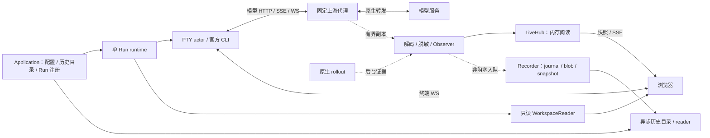

# 本机工作台架构与维护契约

[文档总索引](../README.md) · [交互与 API](../interactions/workbench.md) · [部署与接入](../guides/local-workbench-deployment.md) · [中转架构](relay.md)

本文是电脑端组件的维护入口：先确定责任模块、运行身份和正确性不变量，再进入专题契约与测试。产品目标见[工作台方案](../design/workbench.md)，细节见[详细设计](../design/workbench-detailed-design.md)。本文描述当前实现，不将源码检查当作真实 CLI、模型、手机或部署验收；受测范围见[支持范围](../guides/support.md)。

## 1. 组件边界与非目标

本机 Cargo package `codex-local-observer` 包含 library、默认工作台 binary `codex-view` 和旧兼容 binary `codex-observerd`。工作台运行普通官方 CLI，在指定项目目录通过 PTY 交互，以本次 CLI 显式选择的模型代理观察 HTTP/SSE/WS 内容；官方 binary 和全局配置不修改、不自动升级。浏览器提供原生终端与阅读页面，不建立第二套聊天、审批或工具执行协议。

服务器 package `relay/` 产出 `codex-relayd`，独立部署；电脑端的 `src/workbench/relay` 是可选出站连接器，不要求电脑安装中转服务。两个产品正常/构建依赖只共享协议与静态资源，共享包不反向依赖运行模块；本机对 relay 的 dev-dependency 仅用于跨端测试。公网仅保留 single-origin，页面来自可信中转构建；端点密码实现在电脑与浏览器，Relay 不链接电脑的 `ring` 密码模块。按 Run 复用的加密、作用域和恢复见 [ADR 0066](../decisions/0066-run-scoped-encrypted-relay-channels.md)。

新 API 使用 `/workbench/v1`。旧 `/v1` 保持只读兼容，旧数据库和 audit 不迁移进新运行热路径；已移除的 `/v2` 控制内核不恢复。非目标包括 App Server 控制、remote TUI、持久输入账本、任意网络代理、跨项目共享、自动重放输入、V3 IM 和修改文件/Git 的 Web API。

决策依据：[ADR 0039](../decisions/0039-cc-viewer-style-runtime.md)、[0058](../decisions/0058-admin-accounts-single-origin-relay.md)、[0059](../decisions/0059-workbench-routes-and-relay-recovery.md)、[0060](../decisions/0060-native-provider-command-auth.md)、[0062](../decisions/0062-independent-component-builds.md)。

## 2. 源码责任地图

| 入口 | 责任与维护边界 |
| --- | --- |
| [src/bin/codex-view.rs](../../src/bin/codex-view.rs)、[application.rs](../../src/workbench/application.rs) | 参数与应用编排、配置/历史首页、RunWorker、Run 注册和退出；binary 不承载投影规则 |
| [application/instance.rs](../../src/workbench/application/instance.rs)、[launch/entry.rs](../../src/workbench/launch/entry.rs) | 私有运行目录、实例锁、重复启动握手；不能凭 PID 猜测或删除锁夺权 |
| [application/service.rs](../../src/workbench/application/service.rs)、[application/management.rs](../../src/workbench/application/management.rs) | macOS 用户服务、私有生命周期控制、服务/安装登记与首次接入状态；不恢复 CLI 或扩大中转控制面 |
| [application/launching.rs](../../src/workbench/application/launching.rs)、[launch.rs](../../src/workbench/launch.rs)、[launch/profile.rs](../../src/workbench/launch/profile.rs) | 目标验证、operation 去重、原生配置与认证门禁、CLI 启动；目录/来源快照须在受理及 spawn 前重查 |
| [mod.rs](../../src/workbench/mod.rs) | 单 Run runtime 装配、健康检查、关闭；生产 RunSurface 挂在共享 Application，不每 Run 创建全局首页 |
| [terminal.rs](../../src/workbench/terminal.rs)、[control.rs](../../src/workbench/control.rs)、[terminal/screen.rs](../../src/workbench/terminal/screen.rs) | PTY actor、输入控制代际、输出与 VT 快照；许可检查落到排队命令处理点 |
| [proxy.rs](../../src/workbench/proxy.rs)、[capture.rs](../../src/workbench/capture.rs) | 固定上游转发、HTTP/SSE/WS 与有界观察副本；不能等待页面或磁盘 |
| [framing.rs](../../src/workbench/framing.rs)、[decode.rs](../../src/workbench/decode.rs)、[redaction.rs](../../src/workbench/redaction.rs)、[observe.rs](../../src/workbench/observe.rs) | framing、身份/内容解码、脱敏、安全诊断和捕获缺口；unknown 不静默丢弃或阻断转发 |
| [live.rs](../../src/workbench/live.rs)、[live/view.rs](../../src/workbench/live/view.rs) | 内存 LiveHub、typed ViewItem、revision、用量和调用详情；不是持久保存事实源 |
| [rollout.rs](../../src/workbench/rollout.rs)、[rollout](../../src/workbench/rollout) | 原生 rollout 后台阅读、用户/工具证据；不绑定 Codex 私有 SQLite 表 |
| [recording.rs](../../src/workbench/recording.rs)、[recording](../../src/workbench/recording) | 异步 journal/blob/snapshot、恢复和历史清理；fsync 后才能公布保存水位 |
| [src/history/library](../../src/history/library)、[application/sources.rs](../../src/workbench/application/sources.rs) | 跨来源历史目录、索引与只读 reader；HTTP 请求不扫描全部 store |
| [workspace.rs](../../src/workbench/workspace.rs)、[workspace](../../src/workbench/workspace) | 固定项目根下的文件、rg 搜索和 Git 阅读；有界 worker，不执行任意程序或写入 |
| [config.rs](../../src/workbench/config.rs)、[config_sources.rs](../../src/workbench/config_sources.rs) | 私有 JSON 设置、来源注册、并发修订与保存；CLI override 不回写配置 |
| [web.rs](../../src/workbench/web.rs)、[web/application.rs](../../src/workbench/web/application.rs)、[web](../../src/workbench/web) | Application/Run API、认证、SSE/WS 和页面白名单；不要把未知 API 路径回退成 HTML |
| [web/access](../../src/workbench/web/access)、[remote_access.rs](../../src/workbench/remote_access.rs)、[permission.rs](../../src/workbench/permission.rs)、[lease_clock.rs](../../src/workbench/lease_clock.rs) | 局域网 Run 配对、私有 RemoteOwner ingress、可撤销许可与 suspend-aware lease |
| [relay](../../src/workbench/relay) | 电脑凭据私有保存、设备码登录、出站隧道和有界重连；中转账号不是模型认证 |
| [web/src/workbench](../../web/src/workbench) | Preact 页面、路径/访问上下文、终端与阅读状态；外部内容始终不可信 |

模块公开面与历史双向引用尚有收敛空间，见[开发指南](../development/README.md)。不要通过复制代码、跨目录实现复用或机械拆 crate 引入更多依赖环。

## 3. Application、Run 与数据流



Application 可以没有 CLI：历史首页与配置可用，缺少 CLI、nativeHome 或 profile 只影响启动。每个 Run 拥有独立 TerminalHost、ProxyServer、Observer、RolloutReader、Recorder、LiveHub 和 WorkspaceReader；RunWorker 串行处理启动，避免启动流程阻塞 HTTP runtime。

当前最多 4 个活动 Run、4 个已停止阅读面。同一 canonical 项目最多一个活动 Run，不因不同 nativeHome 放宽；“新建”可返回已有 Run，“恢复指定会话”须先停止该项目活动 Run。跨 Run 的原生会话排他还核对 nativeHome 与已选定/已观察 thread，但迟到的原生身份观察不是完美原生 TUI 锁。新启动成功才退役同项目旧停止面，启动失败保留旧阅读；退役 URL 返回不可用，不能指向另一个 Run。

关闭标签、回首页、切换功能页或断开中转都不停止 CLI。同 Run 切页保留 App/终端组件，隐藏终端不卸载；回应用首页可卸载浏览器组件，进程仍运行。代理/终端健康失败只停止其所属 CLI，不影响其他 Run。停止与正常应用退出清理自己拥有的进程组；SIGKILL、断电或逃离进程组的工具不在保证内。

| 身份/序列 | 含义，不能替代的对象 |
| --- | --- |
| `instanceId` | 一次应用进程，不是持久电脑登记 |
| `runId` / `runEpoch` | 运行路由身份与 PTY/观察上下文；当前使用同一 UUID，但不是 Codex Thread |
| nativeHome + Codex thread/turn/item ID | 原生记录身份；不能用时间、文本相似性或 ID 前缀伪造关联 |
| `viewSeq` / item revision | 实时阅读游标与单 item 增量，不是磁盘水位 |
| `outputSeq` / checkpoint | PTY 输出及屏幕恢复顺序，不是用户提交或模型调用序列 |
| 终端 command `id` / 输入 `sequence` / `generation` | 连接内命令顺序、每 grant 输入顺序、控制权代际，三者不可混用 |
| `recordSeq` / 保存水位 | journal 顺序与实际 fsync 后公布的持久事实，不能以 enqueue/显示成功代替 |

## 4. 必须保持的不变量

### 4.1 原生转发与证据

代理只连固定上游，使用随机能力路径，不提供 CONNECT 或任意 URL 转发。流转发不等待解码、LiveHub、磁盘或浏览器 ACK；有界观察溢出产生捕获缺口并重置 framing 边界，而不是丢转发字节或拼接虚假完整内容。PTY 输入和输出也不依赖观察/记录完成。

模型出站使用 reqwest 的环境与系统 HTTP(S) 代理发现，使 macOS launchd 后台进程无需继承交互 Shell 的代理变量也能使用系统代理。已校验的字面 loopback 模型上游显式绕过所有网络代理；TLS 仍校验系统受信任证书。仅连接建立设 30 秒期限，不设置响应读取或整请求期限。`upstream_failed` 保留原错误码和 requestId，增加固定 `reason`（`timeout/connect/body/request/other`）；不输出底层错误文本、URL、认证头或环境值，`connect` 不进一步断言 DNS 或 TLS 原因。

用户提交仅取原生 rollout 的明确 UserMessage 身份，不从 Enter、终端回显或模型请求 `role:user` 推断。工具参数表示模型生成；工具成功必须有匹配的原生执行/结果证据。关联要求明确调用域和身份，冲突/缺失保持不确定。`response.completed`、用户提交、工具完成、整轮完成和 CLI 退出分别表达。

Live ViewItem schema 2 使用稳定 `itemKey`、revision、orderIndex 和 provenance：首次 `item.replace` 创建项，patch 必须满足基础 revision 与 contentKey，最终完整内容 replace，不再次 append。同一事件的文本、文件/图片上下文、详情与用量不能通过不同恢复路径重复计数。具体契约见[详细设计](../design/workbench-detailed-design.md)。

### 4.2 保存、恢复与历史来源

Recorder 独立有界入队，不让慢存储反压代理。保存顺序为 blob 同步、journal/fsync、meta 原子替换与父目录 fsync，最后公布水位。`persistedThroughViewSeq` 只表示连续已保存前缀，缺口后冻结；`savedThroughViewSeq` 可表示后续保存片段，但不能隐藏缺口。`recorder.status` 不生成 viewSeq，也不再次进入 journal 形成反馈环；退出 flush 有界，未确认尾部明确标为不确定。

历史以 `history/runs/<runEpoch>` 的版本化 journal/blob/meta、项目和生命周期证据恢复；索引可重建，不能把未提交尾部恢复为保存成功。原生 rollout 仍是原生 durable history，不被工作台记录取代。

跨来源目录分开处理 native、workbench 和明确注册的旧 observer。旧库使用零写入 reader/VFS 并保持 WAL 一致性，不启动迁移、writer 或 import，不把活动 WAL 当 immutable。页面只访问已发布目录/reader 的有界队列与缓存，不在请求里全库扫描。目录索引覆盖、搜索覆盖与正文覆盖分别报告；来源撤销立即阻断已有缓存正文访问。

展示归属 `projectId/projectPath/projectBasis` 与恢复输入 `recordedCwd` 分离；同名目录不合并，来源关系不拼成一条虚构完整 thread。恢复须唯一原生 SessionMeta、canonical rollout、可验证原目录/nativeHome 与来源修订，不靠推测关联、`--last`、回放消息或自动 Enter。详情见[历史首页与启动](../design/history-home.md)。

### 4.3 只读项目与不可信内容

WorkspaceReader 绑定启动时验证的 canonical 项目根与目录描述符，拒绝路径逃逸、符号链接/敏感链接与敏感文件；文件大小、rg/Git 输出和 worker 都有边界。Git 阅读禁用可执行扩展，不提供任意 shell、目录或编辑路由。Raw JSON、Markdown、ANSI、HTML、SVG、路径和 diff 都是不可信内容；脱敏不替代 HTML 清洗、纯文本展示与终端控制序列过滤。

## 5. 配置、认证与权限

默认工作台配置为 `$HOME/.codex-web/config/config.json`，默认历史根为 `$HOME/.codex-web/history`，原生 CODEX_HOME 独立选择。私有目录/文件权限为 `0700/0600`。JSON schema 2 可读取 schema 1，不因读取自动写回；默认删除策略关闭。设置保存使用 digest ETag/If-Match、备份、原子替换和 fsync。损坏配置阻止新启动和清理，不中断已运行 CLI；启动/路径设置下次应用启动生效，不自动搬数据或重启。

`runtime/<scope>` 私有实例锁以 flock 保护同一 inode，不强制删除；`instance.json` 的实例能力用于安全 loopback 重复启动握手，不是持久 Run 控制账本。中转绑定凭据与 enabled 意图单独保存在有效配置目录的 `relay/state.json`，不进入普通设置、历史或日志；新配置默认关闭，已保存 enabled 的绑定在应用重启后会出站重连，但不自动恢复 CLI。文件异常使连接器不可用，本机仍可独立运行。

macOS 后台 Application 使用用户级 LaunchAgent，沿用相同实例作用域；服务登记关联固定 binary 和有效路径。CLI 通过私有能力验证的 loopback 控制查询状态/完整退出，远端白名单不含该控制面。服务模式启动、异常恢复和登录自启均不创建 Run；停止先拒绝新启动，再清理全部所属资源并确认退出。首次交互 `start` 根据现有绑定状态打开本机注册页，非交互/系统启动不弹窗；不会替用户选择中转或批准授权。安装器维护检查只管理本安装登记，活动或无法验证的服务阻止升级/卸载，见 [ADR 0063](../decisions/0063-background-service-directory-browser.md)。

Application 的目录浏览器独立于固定根 WorkspaceReader，只为完整 owner 枚举当前层可读目录元信息。规范路径、分页快照、扫描/响应预算及并发限制避免全树扫描；不读正文、不执行 Shell，不影响 PTY/模型转发。选择目录仍走原目标校验与 spawn 前复查，不能通过浏览接口扩大配对设备或 Run 文件权限。

模型认证、配置合法性、provider 选择与传输由官方 CLI 持有。[ADR 0068](../decisions/0068-shared-native-model-capture.md)统一原生 OpenAI 与其他 provider 的捕获链路：启动辅助进程只读原生有效配置、requirements 和账户路由，不创建对话；实际会话继续由普通 CLI 的 PTY 承担。接入只覆写本次进程的代理地址，不要求原生 provider 命名为 custom，不重复校验未知字段、可省略字段或认证形状。代理目的地、来源一致性和内容安全仍有边界。

原生 ChatGPT 的目的地与地区覆盖依据官方账户结果，绑定账户身份并对来源变化设围栏，避免把新凭据发往旧路由；同路由 token 刷新可继续，路由变化要求新 Run，不暗中重放请求。managed 策略禁止地址覆写或无法取得可靠目的地时，CLI 仍正常执行自己的配置检查，捕获明确不可用。WS 的确定请求/响应关联以附加 `responseId` 表达；正文、工具、用户证据、详情和用量共用既有 reducer 和异步保存。旧状态与历史格式继续兼容。

工作台不执行认证命令、不读取命令输出，不缓存动态 token，只转发 CLI 的 Authorization；认证头不进入观察/网页/journal。已知秘密收集只为脱敏，未知动态 token 被上游回显到正文时仍不保证按值识别。版本探测是有界诊断，不是精确版本 allowlist；实际受测范围见[支持文档](../guides/support.md)。

| 权限 | 作用域与排除项 |
| --- | --- |
| 本机 Application owner | 应用/全局历史、启动、共享设置、所有 Run、目录浏览、局域网管理、连接器管理；支持时可用本机目录 picker；服务控制另验私有实例能力 |
| `RemoteOwner` | 账号自有电脑完整 V2 应用/Run、历史/启动/设置、目录浏览与局域网管理；排除连接器登录管理、私有 connect/服务控制、本机 native picker |
| `PairedRun` | 指定 Run 的阅读、终端、文件/搜索/Git、项目历史、已开放的历史管理与停止；终端输入仍须独立 claim；没有全局历史/启动/共享设置/其他 Run/接入管理权限 |

RemoteOwner 只由认证出站连接器通过私有 loopback ingress 建立，不能由公网/LAN Cookie、Origin 或伪造 forwarding header 推导。电脑解密后先检查 exact 路由/作用域白名单，剥离外部认证字段；grant 许可绑定账号、电脑、连接 epoch 与续租，Run 生命周期单独围栏，不能替换 PTY 的 grant 身份。suspend-aware clock 失败、回退、溢出或过期不可逆撤销，无 wall-clock 降级；握手、帧受理及 PTY dequeue 都检查。业务加密不防可信前端/授权方恶意修改，也不提供 OS 沙箱；不同外部账号仍须隔离原生 home、工作台根和历史来源。公网部分见[中转架构](relay.md)。

## 6. 修改与验证入口

标准入口固定 Rust 1.95.0、Node 22.23.2、锁文件依赖；`build/check` 默认 `all`，本机专项使用：

```sh
node scripts/dev.mjs build --component workbench --release
node scripts/dev.mjs check --component workbench --offline
node scripts/dev.mjs docs
node scripts/dev.mjs e2e
```

先构建共享前端再构建 Rust，重新启动新产物；直接 Cargo 默认仅根 package，不等于全量检查。`package` 仅本机受测 macOS 包；产物生命周期、许可、二进制规则和发布步骤见[开发指南](../development/README.md)与[组件部署指南](../guides/component-deployment.md)。

| 改动区域 | 至少核对的回归入口 |
| --- | --- |
| 启动/多 Run/恢复/实例 | [application/tests.rs](../../src/workbench/application/tests.rs)、[launching_tests.rs](../../src/workbench/application/launching_tests.rs)、[multi_run_tests.rs](../../src/workbench/application/multi_run_tests.rs)、[launch/tests.rs](../../src/workbench/launch/tests.rs) |
| PTY/控制/断线 | [control.rs](../../src/workbench/control.rs)、[terminal/tests.rs](../../src/workbench/terminal/tests.rs)、[web/tests/terminal.rs](../../src/workbench/web/tests/terminal.rs)、[terminalClient.test.ts](../../web/src/workbench/terminalClient.test.ts) |
| 模型/framing/身份/脱敏 | [proxy/tests.rs](../../src/workbench/proxy/tests.rs)、[framing/tests.rs](../../src/workbench/framing/tests.rs)、[decode/tests.rs](../../src/workbench/decode/tests.rs)、[rollout/tests.rs](../../src/workbench/rollout/tests.rs)、[live/tests/view_contract.rs](../../src/workbench/live/tests/view_contract.rs) |
| 保存/历史/清理/配置 | [recording/tests.rs](../../src/workbench/recording/tests.rs)、[management/tests.rs](../../src/workbench/recording/management/tests.rs)、[src/history/library](../../src/history/library)、[config/tests.rs](../../src/workbench/config/tests.rs) |
| Workspace/设备/公网许可 | [workspace/tests.rs](../../src/workbench/workspace/tests.rs)、[web/access/tests.rs](../../src/workbench/web/access/tests.rs)、[application/tests/relay.rs](../../src/workbench/application/tests/relay.rs)、[relay/reconnect_tests.rs](../../src/workbench/relay/reconnect_tests.rs)、[permission.rs](../../src/workbench/permission.rs) |
| 页面/路径/访问上下文 | [routes.test.ts](../../web/src/workbench/routes.test.ts)、[context.test.ts](../../web/src/workbench/context.test.ts)、[runApi.test.ts](../../web/src/workbench/runApi.test.ts)、[App.test.tsx](../../web/src/workbench/App.test.tsx)、[web/tests/routes.rs](../../src/workbench/web/tests/routes.rs) |

测试须隔离临时 HOME/USERPROFILE 与 CODEX_HOME，只使用合成/脱敏 fixture；浏览器复用系统 Chrome，不下载 Chromium。真实 CLI、模型、规模压力、ignored 和真实手机网络另列执行条件及结果，不从常规单元测试推导完成。修改身份、路由、schema、捕获/保存或权限契约时联动本手册、[交互手册](../interactions/workbench.md)、相应专题/ADR 与 V2 需求，不复制进度表。
