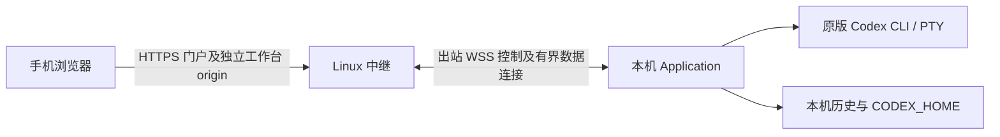

# 公网工作台中继契约

本契约落实 [ADR 0056](decisions/0056-public-workbench-relay.md)。用户已授权通过可信公网服务在手机上使用自己的完整 V2 工作台。本机 Application 仍运行官方 CLI、模型代理和历史记录；Linux 中继仅负责邀请账号、归属路由和流转发。实施与验收状态只见 [V2 实施计划](v2-implementation-plan.md)。

## 用户路径和边界

1. 运维人员在 Linux 服务上创建有时限的邀请；用户在 HTTPS 门户注册并登录。
2. 本机 owner 在首页“公网接入”输入服务 HTTPS 地址与工作台名称，启动设备码绑定；浏览器新窗口打开服务验证页，用户用同一账号确认一次性码。
3. 本机明确开启后建立出站 WSS 连接。门户列出这个账号自己的工作台，点击后进入单独的 HTTPS 工作台 origin；页面的业务操作进入既有 `/workbench/v1`，身份由独立 RemoteOwner ingress 绑定账号和工作台。
4. 本机关闭、忘记服务、服务器撤销或续租失效后停止公网业务连接；已有 CLI 继续运行。重连不得重放输入或自动重试 mutation。

绑定成功只保存凭据，仍需本机点击“开启公网接入”；此后保存启用偏好。忘记时先撤销本机许可并清除绑定，再尝试用工作台凭据撤销服务器登记。服务器不可达时明确显示撤销未确认，不缓存重试；用户应在门户删除该工作台。关闭状态无法落盘时明确提示重启风险。

一个账号可以拥有自己的工作台，但每个工作台只归一个账号。归属给予完整 V2 权限，包括终端输入、文件/搜索/Git 阅读、历史、启动和设置；没有项目共享、角色、逐设备授权、离线工作台或 V3 IM。公网账号不授予服务器 OS 登录权限，也不构成不同本机 OS 用户间的沙箱。公网服务是可信方：它可以读取并控制经过它的工作台内容；首版没有端到端加密。

## 身份与路由契约

域名模式保留门户与每工作台主机隔离。用户 2026-10-13 另行选择的 [单工作台 IP 测试](guides/public-relay-ip-trial.md)使用 `--workbench-origin`、`--fixed-gateway-id`，与 `--workbench-domain` 互斥；只允许一个已绑定工作台，未知 ID 拒绝、第二次绑定返回 409、启动拒绝不兼容数据库。固定地址须为同一字面 IP 的 HTTPS origin、不同显式非默认端口。端口不能隔离 Cookie，该 IP 的其他 HTTPS 服务也属于测试凭据信任边界；见 [ADR 0057](decisions/0057-single-workbench-ip-trial.md)。协议和账号库 schema 不变。

门户和每个工作台使用独立 HTTPS origin。Cookie 为 host-only、Secure、HttpOnly；登录后的工作台入口使用一次性会话交换。中继不接受浏览器声明的 accountId、gatewayId、owner Cookie 或未经验证的转发头。RemoteOwner ingress 只访问已归属的 Application 和 Run，不复用本机 owner Cookie。旧 `/v1` 保持只读，模型代理、私有进程握手、任意 TCP/URL 转发和 V3 实验不经公网路由。

本机 `GET /workbench/v1/application/relay` 返回 `{instanceId,relay}`，`relay` 包含 `state`、`enabled`，可包含 `serverUrl`、`name`、`accountId`、`gatewayId`、`gatewayOrigin`、`binding:{userCode,verificationUrl,expiresInSeconds}` 与安全错误码。`POST /workbench/v1/application/relay/bind` 的 JSON 为 `{instanceId,serverUrl,name}`；`enable`、`disable`、`forget` 的 JSON 均为 `{instanceId}`。写请求要有浏览器 `Origin` 且与本机 owner origin 精确匹配；陈旧 `instanceId`、非 owner、错误 Content-Type 与跨站写入拒绝。前端只显示服务返回的 HTTPS 验证/工作台链接，不在页面加载外部脚本或二维码服务。远程 `GET /workbench/v1/application` 包含 `remoteOwner:true`、`directoryPickerAvailable:false`，隐藏本机绑定入口，启动项目时使用已有路径输入流程。

账号用户名为 1–64 字节的小写 ASCII 字母、数字、`_-.`；密码最少 15、最多 128 字符，拒绝常见密码、重复字符和用户名，不要求字符组合或定期改密。密码采用 Argon2id（64 MiB、3 次、并行度 1）及随机盐，验证并发最多 4 个，账号/IP 按分钟限流；内置常见密码列表不等于完整泄露密码库。参数依据 [OWASP](https://cheatsheetseries.owasp.org/cheatsheets/Password_Storage_Cheat_Sheet.html)和 [NIST](https://pages.nist.gov/800-63-4/sp800-63b.html)。邀请有效期 24 小时，重置链接 15 分钟，均只能使用一次。账号与工作台各有独立可撤销凭据。服务器账号/凭据/路由状态进入私有 SQLite schema 1，原子初始化、幂等重开并拒绝未来 schema；无正文审计只保存时间、事件和身份 UUID，保留不超过 90 天 / 10,000 条。数据库及 sidecar 文件 `0600`、目录 `0700`，拒绝符号链接、硬链接或错误所有者；不迁移工作台历史。过期会话、兑换码和邀请摘要在启动和已有连接维护中按有界批次清理，每分钟最多一次；无连接时在下次启动或连接维护中回收。

| 门户或机器 API | 契约 |
| --- | --- |
| `POST /relay/v1/register`、`reset` | `{token,password}`，一次性兑换；成功后用户登录 |
| `POST /relay/v1/login`、`logout`、`password` | 登录 `{username,password}`；改密 `{oldPassword,password}`；退出或改密撤销所属浏览器会话 |
| `GET /relay/v1/account`、`gateways` | 当前账号和仅其自有工作台 |
| `POST /relay/v1/bindings`、`bindings/{id}/poll` | 工作台 `{name}` 发起；以独立 `deviceCode` 轮询，不向门户暴露工作台凭据 |
| `POST /relay/v1/bindings/preview`、`approve` | 已登录用户用 `{userCode}` 核对名称并确认完整所有者权限 |
| `POST /relay/v1/gateways/{id}/open` | 仅所有者；60 秒、目标 origin 绑定的一次性交换码放入 URL fragment |
| `POST /relay/v1/session/exchange` | 工作台 origin 的 `{code}` 交换 host-only 会话；重复或错误目标拒绝 |
| `DELETE /relay/v1/gateways/{id}` | 门户所有者撤销该工作台 |
| `POST /relay/v1/gateway/revoke` | 连接器用独立 Bearer 凭据撤销自身登记；不接受门户 Cookie 替代凭据 |
| `GET /relay/v1/tunnel`、`tunnel/streams/{id}?epoch=…` | 凭据认证的控制和一次性数据 WSS；协议版本、归属及连接代际校验 |

本机持久 `gatewayId` 与 `instanceId`、`runId/runEpoch`、`connectionEpoch` 分开。连接控制通道每 10 秒续租；30 秒未续租则失效。每个逻辑 HTTP、SSE、终端流使用独立有界 WSS 数据连接；慢页面和慢流不得阻塞控制续租或 CLI。旧实例、旧连接、已撤销账号或工作台凭据均不可再写当前 CLI。错误码和日志可诊断阶段、身份及流序列，但不得包含请求正文、终端输出、密码、Cookie 或凭据。

撤销会取消尚未受理的远程流，并由 PTY actor 复查排队输入许可。启动请求在取得启动 Book 锁后再次复查许可，以该检查作为受理点：等待锁时被撤销的请求返回 `access_revoked` / 401，不创建 operation、不入队。已受理的启动不会回滚或重放，仍用原 operationId 查询；注销、解绑或中转断线均不停止已经启动的 CLI。

## 传输与资源预算

密码验证默认最多 4 个任务，可通过 `--password-workers` 设为 1–4；有限资源测试设为 1，Argon2id 参数不降低。操作系统资源限制独立于下列应用预算，超限允许仅中转服务失败，不能停止本机 CLI。

控制帧、HTTP/SSE 数据帧最多 128 KiB；HTTP 请求正文最多 2 MiB，10 秒内读完。每工作台最多 64 个业务流、服务总计 256 个；每工作台终端 WebSocket 最多 4 个、服务总计 16 个。业务流在读正文前占用额度，贯穿响应和连接生命周期。每流独立读写，不为断线请求积压命令；服务器写超时 10 秒、本机数据写超时 2 秒，慢流关闭后按现有快照/终端恢复机制重新读取。

终端隧道帧上限 16 MiB，覆盖现有最大 200×500 原生彩色 VT 快照及 1 MiB replay 的 JSON/Base64 表示；不把该上限用于普通 HTTP 流。浏览器向终端发送的原生帧仍限制为 96 KiB。控制连接最多 256 个、每工作台同时握手最多 2 个，握手超时 10 秒；门户 JSON mutation 在解码前限制并发 32、正文 8 KiB、读取 10 秒。每连接远程浏览器许可最多 256，租约撤销墓碑和已用 streamId 均有容量边界，超限旋转连接。所有队列、帧和并发额度都失败关闭，原生 CLI 和模型代理不等待这些流。

## 数据与部署隔离

中继本身仅监听 `127.0.0.1:8787`，由 TLS 入口公开门户和工作台 wildcard 域名；门户 DNS、工作台 wildcard DNS 与覆盖两者的证书必须先就绪。Caddy 自动签发 wildcard 证书需要支持 DNS-01 的插件和凭据；也可以显式提供受信任证书。不能把示例 Caddyfile 当作具备自动 wildcard 签发能力。部署步骤见 [Linux 指南](guides/public-relay-deployment.md)。

本机绑定凭据只保存在私有配置目录的 `relay` 子目录，不能写进可公开的统一 JSON 设置或历史索引。同一台机器上若不同账号需要避免彼此看到原生历史，应分别使用 OS 用户或至少独立的工作台根、`CODEX_HOME`、历史数据根与所有历史来源；仅按账号过滤路由无法消除同一进程已有的来源混合。

## 验收与未决

自动化需要覆盖邀请/重置/禁用、Cookie 与 origin 隔离、一次性绑定、撤销、续租过期、不同账号归属、老 `instanceId`/epoch 拒绝、SSE/终端有界背压、断线无重放、本机 CLI 不受慢中继影响。Linux 部署、真实公网 TLS/wildcard DNS、手机浏览器完整 V2 操作和断网恢复必须留存独立实测证据。合成流或桌面浏览器通过不等于公网及手机验收通过。
