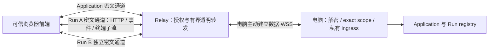

# ADR 0066：按 CLI Run 复用的加密中转通道

- Status: Accepted
- Date: 2026-10-21
- Supersedes: ADR 0056 的明文业务转发与逐请求数据连接、ADR 0057 的双端口模式、ADR 0058 的历史模式兼容；其余账号、归属和撤销约束继续有效。

## Context

中转是用户自行部署的可信前端和授权方，但正常服务器无需读取多用户的终端、历史、文件、查询和设置内容。用户接受运营者能修改 JavaScript 或授权逻辑的限制，不要求独立网站、原生手机客户端、设备配对或持久手机密钥。

Run 对应一个 CLI 进程，当前 runId 等于运行 epoch；原生 Codex Thread 可以在同一 CLI 中改变。历史首页、启动和全局设置没有 Run，必须保留独立 Application 作用域。

## Decision

### 通道与授权

每个浏览器页面分别持有 Application 通道和按需建立的 Run 通道；同 Run 切页复用，不跨标签、手机、Run 或 grant 共享密钥。电脑保留控制 WSS，每条业务通道另建出站数据 WSS，由 Relay 与浏览器 WSS 配对。关闭页面或通道不停止 CLI；CLI 正常退出后仍保留的 Run 阅读面继续可用，只有退役才撤销 Run 生命周期。

外层继续 HTTPS/WSS、精确 Host/Origin、原父 Cookie、固定 grant、账号归属、实例和连接 epoch 检查。新增 `GET /relay/v1/gateways/{id}/access`，仅检查原授权并返回公开上下文，不补发 grant。新增 `/g/{gatewayId}/workbench/v1/secure-channel` WebSocket；公开选择器仅含 grant/API 和 application/run（含 runId）。方法、路径、查询、请求头和正文都在密文内。

电脑按共享 exact 路由分类执行权限检查：Run 列表、创建和 summary 属于 Application；终端、实时、文件与停止属于目标 Run。只读 resolver 返回 registry 中该 Run 的生命周期 fence，和原 RemoteOwner grant 分开；退役不能撤销其他通道或改变 PTY grant/reconnect 身份。授权在握手、Open、业务执行与 PTY dequeue 等受理点检查。

### 密码与记录

使用浏览器 WebCrypto 与电脑 `ring`：临时 P-256 ECDH、HKDF-SHA256、AES-256-GCM。私钥和派生密钥仅驻留端点内存。Relay 不链接端点密码模块，不获得业务密钥。

transcript 是固定顺序二进制：`codex-relay-e2ee-v3\0`、wire/API 各 u32 大端、account/parentSession/grant/gateway/instance/connectionEpoch/channel 各 UUID 原始 16 字节、作用域字节（0 Application；1 Run 后跟 UUID）、客户端与电脑 SEC1 非压缩公钥各 65 字节。握手 JSON 公钥使用标准 Base64。HKDF salt 为 transcript 的 SHA-256；方向 info 为 `codex-relay-v3/c2d` 和 `codex-relay-v3/d2c`。

记录为 u64 大端序号加 AES-GCM 密文及 tag；nonce 是四个零字节加序号，AAD 是 transcript hash 加序号。双方先交换加密 Finished（序号 0），随后业务继续递增。每方向一条串行 writer，分派后才赋序号，赋号后只能发送或关闭整个通道；不能因取消跳过记录。重连或每方向 1 GiB／2^20 条记录限制触发时使用全新握手，不继承子流或密钥。

这依赖可信 Relay 绑定授权，Finished 证明共享密钥一致，不构成对恶意 Relay 的独立设备身份认证。运营者仍能修改前端或授权，元数据、长度和时序也不隐藏。非目标包括恶意运营者防护、离线恢复密钥、任意 TCP/模型代理、文件编辑、V3 IM 和扩大远程权限。

### 子流、背压与完成

加密帧携带 Open/Accepted、Head、Chunk、End、终端 MessageStart/MessageEnd/Ready、Window 和 Reset。Open ID 在实际分派时单调分配、不复用；子流 FIFO，End 不越过正文。迟到的已关闭子流记录仍先验密并推进通道序号，再丢弃。普通业务 403、取消和慢消费只失败该子流；真正父会话/grant 失效才清屏并使全页异步密码回调失效。AEAD、序号、socket 写失败或 TCP 断开影响整个通道。

HTTP 必须收到完整认证 RequestEnd 才执行；ResponseEnd 才能关闭响应正文，无正文响应也等待 End。停止接口验证 `accepted: true`。重连只恢复阅读快照、游标和终端输出，输入及 mutation 不自动重放，未知受理结果按既有 operationId 查询。

分片 16 KiB，记录明文上限 64 KiB（wire 为明文加 24 字节），外层 binary 上限 96 KiB。子流 credit 最大 256 KiB，通道数据队列 2 MiB、控制预留 64 KiB；每电脑和每页面各有 32 MiB 受管传输字节预算，并限制记录数。完整 HTTP 请求（2 MiB/10 秒）与终端消息（手机入站 96 KiB、电脑出站 16 MiB）先预留总长度，再接收/授信；不足拒绝，不持有部分重组等待扩容。每个终端子流的每方向最多一个正在重组的消息。大 HTTP 响应流式传输，不新增小型总正文上限。

上述不是总 RSS 承诺：原 API JSON/快照并发、本机 WS 整消息和页面解析对象保留各自独立上限；小切片不能隐瞒被引用的大底层 allocation。调度保留控制容量并限制高优先级 burst，慢消费者不得阻塞 reader；同 TCP 的网络队头阻塞不能消除。

Relay 改为每电脑 64／全服务 256 条物理业务通道，双向独立 pump，各 128 KiB 有界转发队列及记录数上限。原全局 256 逻辑流／16 终端配额退出；电脑跨通道保留 64 子流／4 终端上限。超限明确拒绝，不驱逐旧页或借用其他页面密钥。

### 前端与升级

本机 fetch/EventSource/WS 保持原路径，远程统一走加密适配层。解密端继续执行方法/路径/头白名单、JSON/SSE MIME 与重定向限制、Markdown/终端安全渲染。远程历史业务状态移至 URL fragment，启动仅消费认证字段，导航合并保留业务字段，避免刷新泄漏搜索。

wire/UI/API 同步升至 3；旧协议明确拒绝，无明文降级。仅保留单 origin，`--single-origin` 可显式声明；移除域名/固定双端口、旧交换码入口和专用模板。数据库仍 schema 3，不删除账号、登记、凭据、表或历史；电脑 Saved/Bound 旧字段继续可读。

## Alternatives

- 独立可信前端/原生手机客户端：信任边界更强，但用户不需要额外分发与部署。
- 每请求握手：隔离更简单，但不满足用户按 CLI Run 复用的选择。
- 所有 Run 共用一条通道：扩大故障域和密钥作用域，拒绝。
- 对 Relay 暴露子流类别以保留全局逻辑配额：增加许可协议；改为约束 Relay 实际分配的通道/字节，内部配额在电脑执行。

## Consequences

减少重复握手，但引入子流流控、调度、共享断线与取消状态机。安全回归须覆盖真实跨端密码互通、截断、错作用域、撤销竞争、迟到帧、预算释放与不重放；构建或桌面手机视口不代表真实手机/TLS/压力验收。必须配套升级三端，不能回退明文，回退需要配套旧版本且不得恢复旧数据库复活权限。
