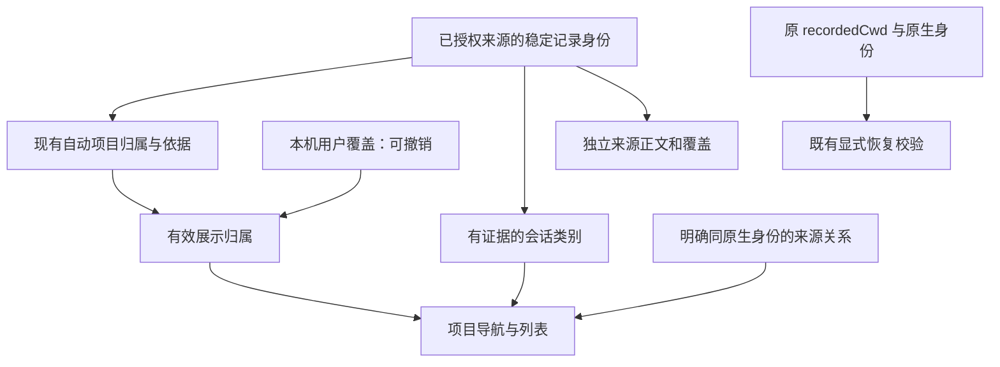

# 项目会话整理：明确归属、分层展示与可撤销纠偏

> 本文件定义项目分组、会话分层、可撤销归属与任务呈现的实现契约。持久化与兼容决定见 [ADR 0055](../decisions/0055-project-session-organization.md)与 [ADR 0064](../decisions/0064-human-conversation-presentation.md)。

## 1. 用户价值与成功标准

打开历史首页后，应能回答：这是什么项目、这里有哪些主要会话、哪些是辅助工作或另一份来源记录、为什么有记录未归类，以及如何纠正归属。

1. 同名项目有可辨认的路径，不因正文搜索、来源筛选或项目分页失去当前项目标题。
2. 默认先看主要会话；子代理、已确认后台审查和工作台运行记录有单独入口与数量，不同级淹没主要会话。未知类型不静默隐藏。
3. 有确切原生身份关联的来源副本可折叠展示，但每份正文、用量、覆盖和恢复能力仍独立。
4. 未归类记录说明原因；用户可将单条记录明确归入已有项目、设为未归类或恢复自动规则。操作可撤销，刷新、重启和重建派生索引后保留。
5. 整理不是清理：没有删除、移动、改写原生会话或旧数据库，没有自动启动 CLI，没有改变恢复 cwd、文件根、运行互斥或手机授权。

## 2. 已核对事实、参考与限制

本次源码基线：本项目 `b0ae129`；token-monitor `542c269b3ceebf7924b118c6057b423230dafe92`，其 vendor manifest 指向 tokscale fork `d5e8ad9b25bfafb43b5b6804940929b728a6f48a`。本次没有读取用户私人会话来衡量噪音比例。

| 事实 | 证据与影响 |
| --- | --- |
| token-monitor 将项目路径身份、会话键和展示分组分开；workspace 无法解码时回退元数据 reader | [路径解析与回退](https://github.com/Javis603/token-monitor/blob/542c269b3ceebf7924b118c6057b423230dafe92/src/shared/sessionMetadata.js)。借鉴证据优先级，不通过 opaque key、标题或正文猜项目 |
| token-monitor 用明确来源判定后台审查，再折叠为一组 | [来源判定](https://github.com/Javis603/token-monitor/blob/542c269b3ceebf7924b118c6057b423230dafe92/src/shared/providers/codex/sessionMetadata.js)、[分组展示](https://github.com/Javis603/token-monitor/blob/542c269b3ceebf7924b118c6057b423230dafe92/src/electron/renderer/sessionRows.js)。借鉴辅助记录折叠，不依赖模型名或提示词 |
| token-monitor 的项目统计按规范化目录名称合并，而非路径 ID | [统计实现](https://github.com/Javis603/token-monitor/blob/542c269b3ceebf7924b118c6057b423230dafe92/src/shared/usage.js)。同名不同路径会相加；本项目不采用该规则 |
| 我们已分开 recordedCwd 与 projectId/projectBasis，处理已知 Desktop 日期目录、旧库 NULL 和父关系冲突 | [归属模型](../../src/history/library/model.rs)、[F.1 契约](history-home.md#14-项目归属纠偏诊断与实现契约)。已有能力不能再作为新改造宣称 |
| 基线首页主/子代理同级混列；项目和会话共用 q/source/group；项目路径来自当前页 | 本次以独立项目查询、selectedProject 和分层组查询替代；[首页实现](../../web/src/workbench/HistoryLibraryPanel.tsx)。原展示问题不等于证明所有现有归属都是错误的 |
| 原生与旧库仅在显式同 nativeHome、同 nativeThreadId 时关联；工作台 Run 不是 thread | [关联实现](../../src/history/library.rs)、[来源契约](history-home.md#52-数据模型与身份)。不能把同名、同 cwd 或近似时间当作副本 |

**项目选择：**继续使用完整路径身份，不扩大 Desktop 启发式；增加展示层次、归属解释和本机显式覆盖。**待验证：**当前受测 CLI 的 rollout 是否提供足以细分 guardian review 的明确字段。token-monitor 读取私有 SQLite 的实现不是本项目的协议依据；没有受测 rollout/公共协议证据时只显示已确认子代理，不开放专门审查判定。

## 3. 范围与非目标

范围仅为 Application owner 的历史首页、项目列表、来源目录与阅读详情。保留已有原生/工作台/旧库 reader 和 R6 的只读/恢复契约，不引入新的第三方运行依赖。

不做 Git 根、worktree、远端仓库或跨目录自动聚合；不按 basename 合并；不调用模型读正文做主题分类；不扫描磁盘寻找项目；不读取 Codex Desktop/T3 私有数据库；不按短标题、空正文、用量为零、目录消失或时间久远删除/隐藏记录。不实现批量整理、拖拽、项目别名管理、任意新路径登记或跨来源正文/Token 合并。本轮单条整理后评估实际体验，再决定是否需要批量操作。

## 4. 分层模型与归属优先级



归属优先级为：**有效且身份相符的用户覆盖 → 当前来源的既有归属规则 → 未归类与原因**。不从另一条同 cwd 记录、父会话或当前打开项目继承归属。保留自动结果与覆盖结果两份元数据；恢复始终只使用原记录身份和 recordedCwd。

新增阅读 DTO，不直接修改原始 schema：

```ts
type ConversationKind = 'ordinary' | 'subagent' | 'background_review' | 'unknown';
type UnassignedReason = 'desktop_generated' | 'source_unassigned'
  | 'missing_cwd' | 'invalid_metadata' | 'identity_conflict' | 'user_unassigned' | 'unknown';
interface Organization {
  automatic: { projectId: string | null; projectPath: string | null; basis: string };
  effective: { projectId: string | null; projectPath: string | null;
    basis: 'user_assigned' | 'user_unassigned' | 'automatic' };
  unassignedReason: UnassignedReason | null;
  conversationKind: ConversationKind;
  kindBasis: string; // 封闭、版本化证据码，不包含 payload
  overrideState: 'none' | 'applied' | 'stale' | 'unavailable';
}
```

- 原生 `conversationKind` 仅采用受测封闭来源变体/明确父关系；review 比一般 subagent 更具体。字段冲突或来源未知记 unknown 并诊断。没有父字段本身不能证明 ordinary。
- 工作台条目是 `kind=workbench` 的运行记录，不据“未捕获父 ID”声称为一个主会话；旧库没有足够类型证据则 unknown。
- 默认主要会话区包含 ordinary 与 unknown；“类型未确认”在行的记录信息内可查，不作为默认任务标签反复展示。仅有确凿证据的辅助记录折叠，不把未知伪装成 ordinary。
- 未归类的中文原因分别为“应用生成的工作目录”“来源未记录项目”“工作目录未记录”“元数据无法解释”“身份信息冲突”“用户设为未归类”“归属未确认”。不将 Desktop 形态解释成官方确认的“用户从未选择项目”。

## 5. 首页交互与统计

### 5.1 稳定的项目导航

保留两栏，不建项目管理页。左侧固定“全部项目”“未归类会话”；项目显示目录名与缩略路径，完整路径可通过键盘/触摸展开，同名路径不只靠 tooltip 区分。缩略只是呈现，API/启动校验仍使用完整路径。

项目导航有独立项目搜索，只搜名称/路径；右侧搜索会话/消息、来源和类别筛选不重排/清空左侧项目。左侧数量是来源记录数，可查其含义；右侧精确计数放在“数量与来源”，注明当前筛选且不宣称唯一对话数。选中项目的摘要独立于项目分页和会话匹配；无结果时仍保留项目名/路径，不取第一条记录推断当前项目。选中项目成为页面主标题，项目路径保持可展开；来源和目录差异不代替任务标题。

`GET /library/projects` 新增 `projectQ`（最多 512 字符）；与旧 `q` 同时提供返回 400，旧 q 契约不变；entries/body 不接受 projectQ。新 UI 不给项目查询传入右侧 q/source/group。`GET /library/entries` 增加 `selectedProject`，从全部启用来源和有效归属解析，包含 ID、路径和状态 `available|missing|indexing|unknown`；available 表示当前可确认项目目录存在，missing 表示目录消失，indexing 表示目录覆盖不足且未取得摘要，unknown 表示不可确认。新建必须有当前 available 摘要，加载或失败时不借备用路径启用。`totalRecords` 为完整当前筛选集合的来源记录数，不从当前页累加；selectedProject 不从当前筛选计算。移除项目筛选继续遵循现有 projectExists 的缺口保护。

### 5.2 默认分层与来源折叠

右侧默认为“主要会话”，下方有“辅助会话 N”“运行记录 N”折叠入口；unknown 在主要区可见。展开只查询相应区的第一页，不预取正文，不将所有区拼成无界列表。按需切换“全部来源记录”使用既有 entries API，供核查全部条目。

原生/Observer 的明确关联可形成一个展示组；行上显示“原生会话 · 另有 1 份来源记录”，展开后可分别选择来源。关联成员要求同已授权 nativeHome、同可靠 nativeThreadId、相同有效项目与类别，且同一来源在已发布目录中对此原生 ID 恰好有一个可靠候选；该唯一性检查不受项目/搜索/来源/类别过滤影响。同来源多主键指向同原生 ID、项目/类型证据冲突或身份无法证明时，涉及的关联候选均各自使用 entryId 形成独立组并保留诊断，不任取一条、不丢成员。工作台 Run 始终单独列为运行记录，不靠标题/cwd/时间并入原生会话。

首选来源为当前筛选内可读 native，其次可读 observer；选择只决定初始阅读入口，不保证 native 比 observer 更完整。每份来源保留 sourceRevision、coverage、正文与能力；不合计成员 Token，不用一份记录补另一份缺口。只有用户明确选择的合格 native 成员可以继续会话，分组本身无 resume 能力。

子代理详情头部提供父会话入口；父缺失/冲突/撤销时说明原因，不按父目录改变项目。源撤销后不能通过组成员或父链接读取旧缓存。

### 5.3 计数、搜索与位置

项目总量是来源记录数；“数量与来源”中分开解释“个展示组”和“条来源记录”，运行区注明“条运行记录”，不宣称全库唯一对话数。默认列表不反复展开技术计数；辅助/运行搜索命中数量与入口仍可见。右侧统计在相同目录、覆盖修订及筛选下计算，覆盖整个匹配集合，不从当前 30 行累加；“未在主要会话中找到”不等于历史没有匹配。

刷新使用类型化状态：后台扫描中、新目录可读取、扫描失败。`POST /library/refresh` 返回当前实例单调 `refreshId`，`GET /library/sources` 返回 `refresh={requested,completed,failed}`；`completed>=refreshId` 才表示该请求已完成（可合并排队请求），不能要求网页采到短暂 indexing，也不能从扫描完成推断目录版本一定改变。扫描入队不显示“已更新完成”；加载新结果时保留选中项目和已打开 entry，重置失效列表分页，不混接新旧 revision。旧链接无新增 view 参数时进入新整理视图，但明确 `group=main|agents` 的旧链接保留其原筛选语义，entry 直达不受默认折叠影响。新的 view/section/projectQ 必须参与 URL、前进/后退和分页状态恢复。

## 6. 可撤销的单条归类

详情提供“调整项目归属”，不在行点击时执行写操作：

1. “归入已有项目”：从当前授权目录的有界项目列表选择，展示完整目标路径。
2. “设为未归类”：明确说明只改展示，不删除记录。
3. “恢复自动归类”：移除用户覆盖，重新使用当下自动规则，不恢复一份过期的自动快照。

保存前显示原标题、原归属、目标归属以及“继续此会话仍使用原工作目录”。一次只改当前 entry，不自动改变同线程另一来源、副本、父或子代理。若因此关联成员分属不同项目，展示组拆开，关系证据仍保留。成功后当前阅读 entry/正文锚点保留，列表和计数取新修订；可以再次调整或恢复自动规则。覆盖不是恢复资格、读取授权或启动信任凭据。

没有可靠稳定主键、身份冲突或已撤销来源的记录不可写覆盖，说明原因；不能以文件名/标题生成新的“可信会话”。目标只接受服务端已有项目 ID，不接受客户端任意文件路径。目标路径不存在仍可用于历史归类，但启动禁用；目录身份变化时按现有启动检查拒绝，不能以展示覆盖绕过。

## 7. 持久化、API 与一致性

### 7.1 原始数据、派生缓存与用户意图分离

用户覆盖不可从 rollout 重建，不能放进可删除的 catalog。新增 `${storage.dataDir}/organization/state.sqlite`（默认 `~/.codex-web/history/organization/state.sqlite`），仅保存用户整理状态，不保存正文、token、原生认证或配置。它是数据而不是第二份设置文件；统一 config.json 和 schemaVersion=2 不变。目录 0700、文件 0600，拒绝链接、未知所有者和路径越界；缓存清理、Run 删除和原有 retention 均不得处理此目录。

自有 schemaVersion=1：

```text
organization_meta(singleton PK, schema_version, store_id, revision)
project_overrides(entry_id PK, source_identity, identity_digest,
                  disposition, project_id NULL, project_path NULL)
```

`disposition=project|unassigned`；automatic 表示删掉覆盖行。identity_digest 为服务端源身份与可靠主键的绑定，不是正文指纹。路径来自保存时核验的项目摘要，项目 ID 与路径成对保存。最大 1,024 条覆盖、加载快照最多 8 MiB；超限拒绝新写，不改变已有值。sourceIdentity/主键变化后旧覆盖留为 dormant，不自动套给新来源；源撤销即时禁用，其重新接入也须精确身份匹配。没有匹配记录时不能因孤立覆盖生造项目或授权来源。

现有 Application 锁按 configDir + dataDir 区分，不保证同数据根只有一个应用。因此采用**数据库事务内 CAS + 每次查询核验共享修订**，而非仅靠进程内串行：历史模块有界串行接入本进程写请求，数据库 `BEGIN IMMEDIATE` 后读取并比较 If-Match、核验源身份/当前目标、修改覆盖并推进 revision，`synchronous=FULL` 提交成功后才发布当前进程不可变快照并回应。修订令牌包含首次创建的随机 store_id 与单调 revision，不以时间计数、不在库重建后复用旧令牌。两个应用携带相同令牌写入只能有一个成功，另一个 409。

所有使用归属的项目/组/entries/详情查询先核验状态库目录、主文件与 sidecar 身份，以不带 CREATE 的受控读写连接允许 SQLite 恢复本项目自己的 hot journal，再进入 query_only 读事务核验修订并加载有界快照；不信任本进程旧缓存。再固定 catalog 已提交读事务和该不可变快照，结束前复查来源授权，不边读边换覆盖版本。catalog 主库始终 READ_ONLY，覆盖仅在连接内 TEMP 表/视图生效。读取线性化于状态修订读取：保存应答后才开始的任一应用查询至少看到该提交或更新的提交；此前开始的查询可完成旧快照，但目录游标继续读取时必须失效。目录 revision/cursor 包含覆盖令牌，不同配置仍各自过滤授权来源；正文窗口游标只绑定来源修订，展示整理不破坏原正文锚点。

首次保存在随机 `pending-UUID.sqlite` 内同一 FULL 事务初始化唯一 store_id 并提交首条意图，再以不覆盖现有文件的发布操作命名为 state.sqlite 并同步目录，完成后才 ACK。有界 bootstrap.lock 协调首次发布及读取恢复，不替代事务内 CAS；并发 absent 只能一个成功。验证/预算失败或发布前崩溃遗留的私有 pending 文件不视为正式状态，保留诊断、不自动清理，不留下可误读的正式空库。提交后崩溃、ACK 遗失通过重新读取状态核对，不盲目重发、不创建控制账本。索引后台仍记录自动结果，原始来源授权变化需在保存回应前复核；若提交后撤销发生，覆盖保留 dormant，但不返回已撤销 entry 的路径或成功展示状态。记录器、proxy、PTY 不等待本操作。

首次确认为缺失的文件表示没有覆盖且只读访问不创建数据库；首次明确保存才创建。已观察过有效库后文件突然消失、替换或 store_id 改变，按状态变化/不可用处理，旧 If-Match/游标不能继续使用。损坏、未知版本、锁/写满与初始缺失必须区分：有故障时项目/组/编辑入口明确不可用，不覆盖成空库，不把自动结果标成已经整理完成。独立来源正文仍可读取，DTO 明确 overrideState=unavailable；可靠原生 entry 的显式恢复仍验证原 cwd/身份，不借用户覆盖决定恢复路径。新建项目保持严格失败，不能借来源降级绕过项目查询。旧版本回退不删除该目录；旧 binary 不使用新覆盖，新视图不能声称其分组一致。跨数据根不迁移覆盖。

### 7.2 新接口与版本

以下接口均位于 `/workbench/v1`，仅 Application owner；写入另验同源 Origin、instanceId、JSON/body 上限，不给手机 Run 配对开放。

| 接口 | 具体契约 |
| --- | --- |
| `GET /library/session-groups` | `projectId/sourceId/kind/q/section/cursor/limit`；section=`primary|auxiliary|runs`，默认 primary；默认 30/最大 200 组。先校验成员身份和有效归属，再过滤/分组/排序/分页，不做前端逐页去重 |
| 同接口响应 | `{ revision, organizationRevision, records: SessionGroup[], nextCursor, coverage, selectedProject, counts }`；counts 为相同 project/source/kind/q 下各区 groups/records，全结果范围且不受当前 section/页影响 |
| `GET /library/session-groups/{groupId}` | 必须提供当前组的 `anchorEntryId` 和列表 `revision`；以该可靠成员定点解析同组，不查询整个项目页。仅返回当前授权、有效项目/类别一致的全部组成员摘要，不接受 q/sourceId/kind，不读取正文。来源/目录/覆盖修订或该 anchor 的 groupId 变化返回 409；anchor 已不可用 404；同来源候选歧义按既定独立组规则处理，不能扩大分组 |
| `GET /library/entries/{entryId}/organization` | 当前 Organization、覆盖修订和是否可调整；源撤销不返回保存的路径/覆盖；404 不可用、503 状态库不可读 |
| `PUT /library/entries/{entryId}/organization` | 强 ETag `If-Match: "organizationRevision"`（必须引号，拒绝 W/*、列表和重复值）；body=`{instanceId,sourceIdentity,sourceRevision,action:"project"|"unassigned"|"automatic",projectId?}`；仅 project 允许且必须有 projectId；GET/成功 PUT 返回带引号 ETag |
| 保存响应 | 当前已提交 Organization、organizationRevision、新的目录 revision；回应前覆盖快照可用于查询；400 非法字段，401 未认证，403 非 owner/Origin，404 entry/目标不可用，409 修订/来源/实例/身份变化，413 body/覆盖预算超限，428 缺少 If-Match，503 存储/队列故障 |

```ts
interface SessionGroup {
  groupId: string; // 同 nativeHome/thread/有效项目/类别的有界身份摘要；无证据则绑定 entryId
  section: 'primary' | 'auxiliary' | 'runs';
  conversationKind: ConversationKind; // Run 保持 unknown，section=runs 独立表达其身份
  preferredEntryId: string;
  members: { entryId: string; sourceId: string; kind: string; sourceRevision: string;
    title: string; preview?: { text: string; role: 'user' | 'assistant' } | null;
    coverage: Coverage; capabilities: HistoryEntry['capabilities'];
    match?: { record: number; text: string; sourceRevision: string } }[];
  // 项目/时间来自已验证成员；时间排序只是展示顺序，不是 turn 全序。
  projectId: string | null; projectPath: string | null; latestRecordedAt: string | null;
}
```

先基于所有已发布、已授权候选校验身份唯一性和分组资格，再在成员级应用 projectId/sourceId/kind/q；仅用符合筛选的成员构造响应、时间排序和 counts（records 为命中成员数，groups 为至少有一个命中成员的组数）。q 沿用现有元数据/脱敏搜索覆盖，正文命中的成员返回原有 match 定位；搜索时 preferredEntryId 优先有正文命中的可读成员，再依 native/observer 顺序及 entryId 稳定决胜。仅 Observer 命中时不能默认打开未命中的 native。标题/项目等元数据命中但无正文定位时从该成员顶部阅读，不伪造 record。展开不隐式加入未命中成员；明确点击“查看全部关联来源”才以 groupId/当前可见 anchor/revision 定点取得全组摘要，不改变主列表筛选或 counts，也不将原来源 match 用到另一成员正文。若关联记录因有效项目/类别不同不能成组，仍可通过详情既有 relatedEntryIds 独立跳转，但不得把它加入当前组。

由于每来源原生 ID 候选必须唯一，每组最多一个成员/来源，当前总来源上限为自动 2 + 最多显式 8；任何歧义候选单独分组，不通过成员裁剪掩盖冲突。全授权候选在筛选前限制 100,000 条及 metadata+locator 累计 64 MiB；超限返回 query_budget_exceeded/413，提示切换全部来源记录，不建议缩小筛选绕过资格核验。响应仍限 1 MiB；groupId 不因只选其中一个来源或 q 命中改变。组分页游标绑定目录、归属规则版本、覆盖令牌、来源授权和全部查询参数，稳定排序为最近命中成员时间再 groupId；任何变化返回 409。旧 entries/body/detail API 的来源独立语义不变，新增分类字段需同步 TS/API 测试。

派生目录需递增投影版本以重读新的类型证据，不能复用没有这些字段的旧 checkpoint。只重建 catalog，不迁移原始库/journal，不删除 organization 状态。项目计数、有效归属和组查询必须使用相同规则函数/快照，不能各处复制分类判断。

## 8. 安全、故障与验收矩阵

| 场景 | 必须验证 |
| --- | --- |
| 项目明确性 | 同名不同路径分开；项目不在当前分页、正文搜索无结果、来源/类别过滤后标题路径仍稳定；项目目录消失只禁启动 |
| 类型证据 | 明确子代理/父冲突/未知来源；review 无受测证据则保持一般辅助/unknown；同模型名普通会话不得误折叠；unknown 首屏可达 |
| 噪音分层 | 主要、辅助、运行区数量覆盖所有符合筛选的记录；默认折叠不是删除；辅助搜索命中有入口；旧 entry/group URL、刷新和前后退正确 |
| 来源关系与搜索 | 同 nativeHome+thread 可分组；不同 home 同 UUID、同标题/时间/cwd、工作台多 thread Run 不合并；同 Observer 多 threadKey 指同原生 ID 在所有筛选下仍各自保留；成员有效项目/类型冲突拆开；仅 Observer 正文命中时准确选中该成员及 match 定位；单来源正文/Token/coverage 不串 |
| 单条整理 | project/unassigned/automatic、重启、缓存重建、目录消失、来源重配/dormant；两个 config 共享 dataDir 的首次创建/同 If-Match 并发写/跨应用读后写/重启；ACK 丢失、提交前后 crash、库消失/替换、锁/损坏/未知版本/磁盘满、预算满，不谎报保存 |
| 启动与权限 | 跨项目归类后 resume 仍用原 cwd/SessionMeta.id；新建用选中项目真实目录；身份/来源变更拒绝；手机、跨 Origin、伪造路径/ID、链接与父/来源跳转负向 |
| 原始数据与实时隔离 | 合成 rollout、schema 20/25 主库/WAL/SHM/audit、Run journal 前后零写；后台整理/慢存储不挡模型/PTY，不自动 spawn/input；活动 Run 不被归类合并 |
| UI/资源 | 系统 Chrome 320/736/1440px、同名长路径、键盘/触摸、焦点/正文锚点；分页与 1 MiB/成员/覆盖预算；10k 合成记录暖查询沿用 R6 p95 ≤200ms 基线 |

先增加能复现首页标题、混列/副本和覆盖丢失的合成回归，再实现；真实 CLI 使用临时 HOME/USERPROFILE/CODEX_HOME。每片运行相关 Rust/Web 测试、formatter/Clippy/类型检查、先 Web 后 Rust 的标准 build；文档执行 `node scripts/dev.mjs docs`。浏览器只复用系统 Chrome。完整跨源分组、持久化和权限新增须独立审查，不能用 token-monitor 的测试替代本项目验收。

## 9. 剩余风险

原生元数据不能表达全部用户项目意图；新增 guardian 字段须有公共协议或受测 rollout 证据。明确关系只能折叠部分来源副本，单条操作也可能不足以整理大量记录，但不能据此自动扩大为批量重归类。存储、权限与恢复需独立复核，并针对合成故障、跨应用并发和真实 CLI 单独验证；no-daemon profile 的结果不能外推默认 daemon、物理故障或全部用户历史。

## 10. 试用改进：任务识别与人类对话优先

任务呈现优先提供有意义标题、正文对话、任务/交流预览/时间列表和当前项目主标题。决定见 [ADR 0064](../decisions/0064-human-conversation-presentation.md)。

### 10.1 标题与交流预览

在已授权来源内完成派生呈现，不调用模型，不读取 Desktop 私有数据库，不重命名原始会话。优先保留当前来源已存的有效语义标题（例如 Observer 的 `name`）；否则取第一条真实用户请求，最多 120 个 Unicode 字符。工作台项目名不是任务标题；没有可确认用户请求时保留“未命名会话”，不编造主题。

只有完整、已确认形状的包装可识别为注入上下文：AGENTS 标头加闭合 INSTRUCTIONS、已知封闭 environment_context，以及精确 `{page_id:null}` 的 external_codex_apps_open_page。混合消息保留包装之外的真实请求；不因出现 AGENTS、XML、代码或“系统”字样而删除用户讨论，畸形/未知包装保守作为正文。原始脱敏字段始终留在详情。

Entry 和 SessionGroup 成员新增可选 `preview: {text: string; role: 'user'|'assistant'} | null`，最多 240 个 Unicode 字符，是当前来源已观察的最近有效交流片段，不是模型生成的任务总结，也不表示任务完成。native 流扫描在正文缓存满后仍可更新有界预览；Observer/Workbench 只在原有预算内选取已观察交流，不保证未读取尾部的全源最新。标题、预览和正文使用同一纯呈现规则且脱敏，不从另一份来源借用预览。派生 catalog 投影由 3 升到 4，仅重建缓存；organization schema 1 与配置 schema 2 不变。

### 10.2 默认阅读与核查

正文 DTO 增加 `presentation: conversation|context|activity|attention`，保持 kind、role、detailCursor 和详情 raw；conversation 表示真实用户请求/助手交流，context 为已确认上下文，activity 为工具/内部/unknown，attention 为错误或记录缺口。默认对话视图聚合连续 context/activity 为有限折叠入口；unknown 可展开核查，attention 一直显示。可切到“全部记录”，不删除、合并或改写来源正文。

首个窗口只有上下文时，最多自动定位 8 个窗口/128 条记录到首个对话；遇到错误/缺口停止自动跳读。超限或没有对话给出说明及普通后续阅读入口，不无限扫描。搜索命中窗口自动展开，工具/上下文命中不能被默认折叠遮住。原有来源修订、分页、三窗口虚拟阅读、撤销、焦点和锚点仍有效；改变显示方式不改变恢复 cwd/线程或启动任何 CLI。滚动选择窗口时保留仍与视口相交的已挂载块；详情期间固定来源窗口，卸载详情后恢复按钮焦点且不隐式滚动。迟到读取按当前窗口淘汰缓存，不能按请求开始时的位置移除当前内容；仍保持三块/48 条挂载、五块摘要缓存的预算，不承诺同时填满多个短折叠块的整屏。

### 10.3 默认信息层级与验收

行主内容为任务标题、该来源交流预览和记录时间。预览只展示安全纯文本，优先保留交流叙述，排除呈现标记和代码块；行内标识符保留，仅代码的片段可回退代码文本，不凭空补总结。仅在跨项目范围补充项目名；来源、完整路径、未知类别、精确数量和关联来源操作收进次级入口，辅助/运行按钮不重复精确技术计数。正常目录更新与搜索缓存范围轻量提示，失败、缺口和来源不可用仍明确显示。选中项目成为 h1 和标签页标题；加载/无结果不能借某条记录猜项目，主标题、路径和启动资格仍来自稳定项目摘要。

验收必须包含长 AGENTS/环境前缀后真实请求、混合/畸形/引用 XML、既有标题保留、来源独立预览、上下文/unknown/工具按需读取、错误/缺口与搜索命中可见、长前缀有界处理、显示切换/展开锚点、320/736/1440px 实际 Chrome 和 catalog 3 重建原始数据零写。仅测试数据模型和数量正确不足以宣称任务识别体验通过。不增加自动主题分类、任务完成推断、项目合并、worktree、批量整理或原始历史清理。
