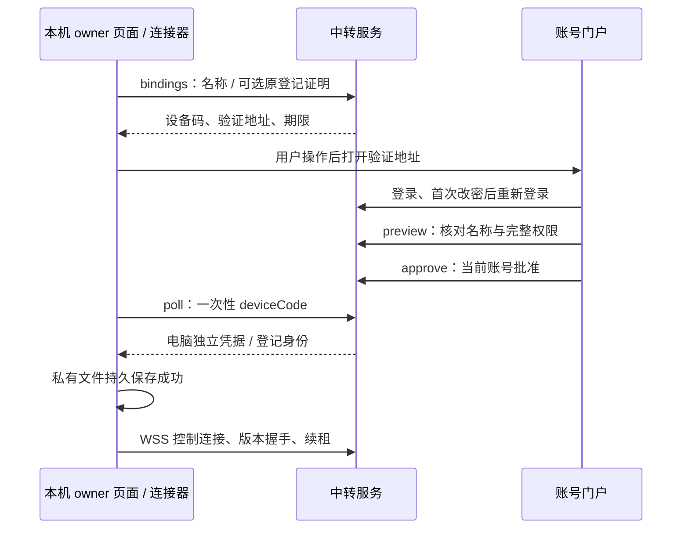

# 公网中转交互与 API 契约

[文档总索引](../README.md) · [架构与安全](../architecture/relay.md) · [部署运维](../guides/public-relay-deployment.md) · [本机交互](workbench.md)

本文描述当前账号、电脑认证、固定工作台页面和撤销流程，供维护者追踪用户操作到代码。运行预算、依赖和 schema 不变量见架构文档；唯一阶段状态仍是 [V2 实施计划](../v2-implementation-plan.md)。不提供公开注册、跨用户管理电脑、离线访问或另一套 Codex 模型认证。

## 1. 登录与门户页面

默认管理员用户名 `windsyu`，角色 `admin`，首次密码由部署者通过私有密码文件初始化，没有公开默认密码。首次登录 admin 或普通用户均须改密；受限会话只能读取账号信息、改密或退出。改密撤销包含当前会话在内的全部登录，重新登录后才能进入电脑/授权/管理页面。

门户入口：`/login` 登录，`/computers` 我的电脑，`/authorize` 核对设备码，`/account/security` 改密，`/admin/users` 管理用户；`/` 根据当前状态进入门户。页面导航由 [portal.js](../../relay/static/portal.js) 管理，服务器路由见 [lib.rs](../../relay/src/lib.rs)。前端是否显示按钮不是权限判定，接口和事务必须再次鉴权。

管理员只能创建普通用户、给出临时密码、重置临时密码、禁用/恢复或永久删除普通用户，不能删除自己或其他管理员，不能进入其他用户电脑。临时密码应安全交给本人，不出现在 URL、日志或 Git。重置/禁用立即全端撤销；启用不恢复旧授权。删除确认后永久清除中转账号、电脑登记和全部登录，保留审计，不删除电脑原生历史或停止其 CLI。同名重新创建是新身份，必须重新登记电脑。

## 2. 电脑端“登录并开启”

本机独立使用不要求中转账号；模型 API 认证仍由本机官方 CLI 处理，与中转网页登录互不替代。电脑端流程从本机 owner 的“公网接入”开始：

填入 HTTPS 门户地址和电脑名称，点击“登录并开启公网接入”。弹窗被拦截时提供显式验证链接，不因页面加载或普通状态轮询自动弹窗。门户必须展示电脑名称、一次性码及完整工作台权限，用户明确批准。电脑通过设备码领取独立凭据，门户不显示 secret，电脑不保存账号密码。

连接器在凭据私有落盘成功后才启用连接。取消登录、用户已关闭连接、保存失败或迟到的批准结果均不能重新开启。重启、关闭后再开启或网络恢复可用保存的凭据重连；认证失效停止无效重连并显示需要重新登录。

macOS `code-view start` 首次交互启动无绑定时会打开本机 `/relay`，注册仍按上述用户输入可信地址、登录、核对和明确批准完成，不自动绑定预设服务器。已有绑定不重复提示，已关闭的接入保持关闭；非交互/系统自启只启动本机服务，不弹浏览器。后台恢复连接不自动恢复 CLI。

| 本机动作/状态 | 持久与运行结果 |
| --- | --- |
| 登录中 `binding` | 有时限设备码和显式验证地址；可取消，不自动获得权限 |
| 已关闭 `disabled` | 不连接，保留电脑登录；再次开启可重连 |
| `connecting` / `online` | 使用独立凭据连接/续租；在线不保证 API 版本兼容 |
| `offline` | 等待网络恢复后有界重连，旧连接许可失效，输入不重放 |
| `authenticationRequired` | 密码变化或撤销后的登录不可继续；保留登记恢复证明，需原账号再次批准 |
| `bindingFailed` / `error` | 授权过期/失败或凭据保存失败；显示安全错误，不连接 |
| 取消登录 / 关闭接入 | 终止该次异步授权意图；迟到结果不复活 |
| 退出登录并撤销接入 `forget` | 先清理本机凭据/许可，再有界尝试删除服务端登记；未确认须提示到门户删除 |

表中状态名以 [连接器](../../src/workbench/relay/mod.rs)序列化契约为准；错误信息必须给出安全错误码，不能暴露凭据。原登记重新认证须成对提交 `resumeGatewayId` 和 `resumeCredential` 并由原账号批准，仅电脑 ID 或另一账号不行。丢失私有状态时新建登记，不采集硬件指纹。

## 3. 手机与多电脑页面

手机访问统一 HTTPS 门户，登录与电脑认证相同账号，在“我的电脑”选择在线且兼容的电脑。无需扫描本机局域网配对码，也无需为每台电脑开放入站端口。可同时打开多台电脑，每页固定一个电脑及原登录会话。

列表状态区分：离线 `offline`（无有效控制连接）、需要重新认证 `reauthenticationRequired`（账号与登记代际不符）、版本不兼容 `versionIncompatible`（工作台 API 版本不符）、在线可打开 `online`；首次批准但尚未收到握手版本为 `awaitingConnection`。电脑名仅展示信息，真正路由使用 `gatewayId`；不得按名字或列表位置选择后端。admin 同样只看到自己的电脑。门户列表状态与本机连接器状态是两个契约，不要混用。

1. 门户 `POST /relay/v1/gateways/{id}/open`，明确提交当前 `uiApiVersion`。
2. 服务校验账号已改密、归属、凭据代际、在线连接及版本，创建固定子授权并返回 URL。
3. 单端口 URL 形如 `/g/{gatewayId}/#…`，fragment 携带上下文；前端消费后清除 fragment，并保存到本标签 sessionStorage。
4. 工作台 HTML/JS/CSS 全部来自中转构建；后续每个 HTTP/SSE/WS 请求带固定授权，并同时匹配原门户父 Cookie。
5. 刷新恢复原上下文，导航和新标签链接显式携带同一上下文；缺少或过期授权回门户重新打开，不凭当前 Cookie 自动补授。

工作台功能路径包括 `/g/{id}/history`、`/g/{id}/launch`、`/g/{id}/settings` 和 `/g/{id}/runs/{runId}/{chat|terminal|files|search|git|history|usage|settings|access}`，运行与应用接口都在该电脑前缀下；页面白名单以 [relay-protocol](../../crates/relay-protocol/src/lib.rs) 为准。返回工作台首页仍保留电脑上下文；回中转门户使用门户入口，不能误发到另一电脑。本机根路径继续独立回归。

门户退出只撤销当前父会话及其工作台授权，不退出电脑账号。切换账号/重新登录也不能给旧页面借用新 Cookie；旧页收到授权失败后清屏、关闭 SSE/终端，必须显式从门户重新打开。浏览器状态按会话、电脑及应用/运行实例隔离，不能把 A 的目录、阅读位置、输入或 operationId 恢复到 B。

## 4. 账号与设备 API

所有门户操作都走精确 Origin/Host、受限正文与服务端鉴权。以下 payload 是业务字段，不包含 Cookie、密码哈希或电脑 secret 的日志样例。

| 方法 / `/relay/v1` 路径 | 请求与结果 |
| --- | --- |
| `POST /login` | `{username,password}`；签发门户 Cookie，临时密码仍受限 |
| `GET /account` | 返回 `accountId,username,role,mustChangePassword` |
| `POST /logout` | 当前门户父会话及其页面授权失效，电脑登录保留 |
| `POST /password` | `{oldPassword,password}`；原密码验证、事务更新、全端撤销 |
| `GET /admin/users` | 管理员列表，有界，不赋予电脑权限 |
| `POST /admin/users` | `{username,temporaryPassword}`；创建普通账号，强制首次改密 |
| `POST /admin/users/{id}/password` | `{temporaryPassword}`；强制改密、全端撤销 |
| `POST /admin/users/{id}/disable`、`/enable` | 禁用/恢复普通用户；启用不恢复旧授权 |
| `DELETE /admin/users/{id}` | 删除普通账号及关联接入，204 无正文；禁止删自身/admin |
| `GET /gateways` | 自有电脑与在线/认证/兼容状态，无管理员例外 |
| `POST /bindings` | `{name,resumeGatewayId?,resumeCredential?}`；恢复字段成对，返回设备码/期限/验证地址 |
| `POST /bindings/{id}/poll` | `{deviceCode}`；本机领取独立凭据，门户看不到 secret |
| `POST /bindings/preview`、`/approve` | `{userCode}`；当前已改密账号核对/批准，恢复登记须原账号 |
| `POST /gateways/{id}/open` | 单端口 `{uiApiVersion:1}`；返回固定页面授权 URL |
| `DELETE /gateways/{id}` | 所有者删除电脑登记，关闭接入，不修改本机历史 |
| `POST /gateway/revoke` | 独立 Bearer 电脑凭据撤销自身登记，Cookie 不能代替 |
| `GET /tunnel` | 独立电脑凭据认证的控制 WSS |
| `GET /tunnel/streams/{id}?epoch=…` | 对应连接 epoch 与 stream 的独立数据 WSS |
| `POST /session/exchange` | 仅历史域名/固定模式，`{code}` 一次性交换，不能用于单端口绕过 grant |

原邀请注册/重置兑换路由和 `invite/reset/disable` CLI 已停用，不能在新 agent 部署脚本中恢复。仅 `serve` 与停服后的 `recover-admin --password-file PATH` 是当前服务 CLI；管理员恢复、初始化密码文件和 schema 操作只按部署指南。

## 5. 本机连接器 API 与业务转发

本机 `GET /workbench/v1/application/relay` 返回 `{instanceId,relay}`：状态、enabled、服务器地址、电脑名、username、账号/电脑 ID、验证地址及安全错误码。`POST .../relay/bind` 提交 `{instanceId,serverUrl,name}`；`enable/disable/forget` 提交 `{instanceId}`。只接受本机 owner、精确 Origin、JSON、小正文和当前 `instanceId`，远程页不能管理连接器。取消由 `disable` 终止正在进行的登录意图。

远程 Application 标记 `remoteOwner:true`、`directoryPickerAvailable:false`；RemoteOwner 可管理自有工作台的 V2 项目、历史及设置，但不能打开本机 native picker 或管理中转登录。局域网配对权限只属于指定 Run，不是完整 RemoteOwner。

新电脑可另外报告 `directoryBrowserAvailable:true`。远端启动表单的“浏览电脑目录”调用 `/g/{id}/workbench/v1/application/directories`，按固定电脑授权读取目录元信息；选择后进入原目标校验，不直接启动 CLI。旧电脑无能力时继续手动输入；无权限、电脑离线、目录变化和预算不完整均明确展示。列表请求也必须重验授权，不能在账号/电脑/实例变化后展示旧响应。详细字段与分页预算见[本机目录契约](workbench.md#3-项目校验新建与恢复)。本机后台服务控制不加入中转白名单。

业务转发必须满足固定 grant、原父 Cookie、同账号归属、授权代际、在线 connection epoch 和 `WORKBENCH_API_VERSION`。HTTP 通过两项 `X-Workbench-*` 头传 selectors，SSE/WS 用 `relayGrant`、`relayApi` query；重复、编码别名、混用头/query 或非 canonical 电脑路径拒绝。中转保留业务 query 原始字节，剥离 selectors/认证信息及电脑路径前缀后，通过白名单转发。

SSE 是观察副本，不得阻塞原生模型流；终端输入仍交给当前 Run 的原版 CLI。连接关闭时不缓存待发输入；重连只恢复同一 Run 的终端连接及阅读状态，不重放键盘、审批或项目启动。启动响应中断时按原 `operationId` 查询受理结果，不盲目重发创建。

## 6. 失效、错误与维护回归

| 情况 | 用户可见行为 / 禁止的恢复方式 |
| --- | --- |
| 临时密码未更改 | 提示先改密；不能隐藏提示后直接调用管理/电脑接口 |
| 改密、重置或禁用 | 所有网页/电脑凭据失效、流关闭；电脑需重新认证，本机 CLI 继续 |
| 普通账号启用 | 可用当前密码登录，仍须遵守强制改密；旧凭据不恢复 |
| 电脑离线/epoch 改变 | 显示断线或不可用；不把旧数据流接到新连接 |
| API 版本不匹配 | 显示版本不兼容并要求配套升级；不加载电脑脚本 |
| 页面授权过期/换账号 | 清屏并关闭流，回门户显式重新打开；不自动借新身份 |
| 恶意 HTML/SVG/脚本 MIME、重定向或路径逃逸 | 中转拒绝，不能作为门户内容执行 |
| 配额/限流或慢连接 | 有界失败/重试，不能无限积累或阻塞 CLI |
| 本机保存失败/取消/迟到批准 | 保持未启用，明确错误；轮询不能重新激活 |
| schema 冲突/不兼容 | 停止启动，保全数据库；不自动降级或恢复旧快照 |

服务低层通常以 HTTP 400（非法输入）、401（认证/授权失效）、404（未知/不公开目标）、409（兼容冲突）、429（预算/限流）、503（电脑不可用）拒绝；具体 body/错误码以相应源码与契约测试为准，UI 不应仅根据 HTTP 成功判断在线或已改密。

新增流程先补可复现的负向/并发测试：服务端 [account_api_tests.rs](../../relay/src/account_api_tests.rs)、[account_store_tests.rs](../../relay/src/account_store_tests.rs)、[tests.rs](../../relay/src/tests.rs)；电脑端 [login_tests.rs](../../src/workbench/relay/login_tests.rs)、[reconnect_tests.rs](../../src/workbench/relay/reconnect_tests.rs)；前端 context/routes/runApi/terminal 与门户测试。系统 Chrome 专项入口为 [relay-single-origin-probe.cjs](../../web/e2e/relay-single-origin-probe.cjs) 和 [relay-account-probe.cjs](../../web/e2e/relay-account-probe.cjs)。测试须使用合成账号、私有临时 HOME/CODEX_HOME 和隔离数据目录，不操作真实账号或停止用户 CLI。

最终验收至少同账号两台电脑、另一账号一台，同时验证打开/刷新/新标签/换账号/断网/撤销，不串电脑、不借新身份、不重放输入；真实手机网络与 TLS 另记录，桌面 Chrome 手机视口不替代。修改时同步两份维护文档、部署说明、ADR 和 V2 对应需求，不新建第二套状态表。
