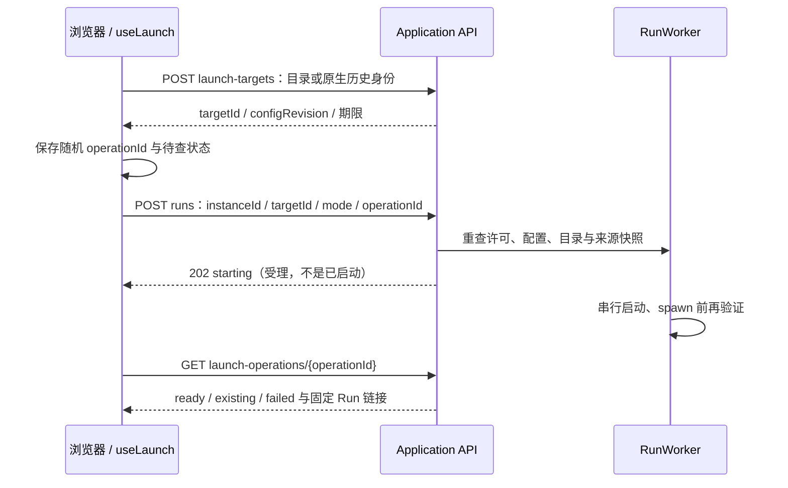

# 本机工作台交互与 API 契约

[文档总索引](../README.md) · [架构与安全](../architecture/workbench.md) · [部署与接入](../guides/local-workbench-deployment.md) · [中转交互](relay.md)

本文按用户操作追踪 Application、Run、阅读与终端接口，供开发和维护定位。身份、存储及安全不变量见架构手册；完整字段/错误契约继续由[详细设计](../codex-native-cli-workbench-detailed-design.md)、[历史首页与启动](../codex-native-cli-workbench-history-home.md)、[设置与历史管理](../codex-native-cli-workbench-history-settings.md)、[设备接入](../codex-native-cli-workbench-device-access.md)负责。实施与验收状态只在 [V2 实施计划](../v2-implementation-plan.md)，本文不另建状态表。

## 1. 页面、接口与作用域

应用页为 `/`、`/history`、`/launch`、`/settings` 和本机 owner 的 `/relay`。Run 页为 `/runs/{runId}/{chat|terminal|files|search|git|history|usage|settings|access}`，实际可用页由后端 capability 决定。调用详情是阅读面板，不是独立 `/requests` 页面。旧 `/?run=<uuid>` 规范化为该 Run 的 chat 页，不启动 CLI。未知页面/API/资源不会通用回退成可执行 HTML。

公网单 origin 在全部工作台页面和业务 API 前加 `/g/{gatewayId}`；应用 `/relay` 不对远程开放。URL 构造统一使用 [routes.ts](../../web/src/workbench/routes.ts)、[navigation.tsx](../../web/src/workbench/navigation.tsx)、[runApi.ts](../../web/src/workbench/runApi.ts)，不要硬编码根路径而丢失电脑或 Run selector。

下文用 `A=/workbench/v1`，`R=/workbench/v1/runs/{runId}`。Application API 使用 `instanceId`，Run API 使用当前 `runEpoch`；两者不能互换。配对设备只能访问指定 Run，不因为能读页面就获得 Application 权限。RemoteOwner 是完整自有电脑 V2 权限，但不能管理中转连接器或打开本机 picker，详见架构权限表。

## 2. 启动应用与浏览器 bootstrap

`codex-view` 先建立私有实例锁、配置服务、历史目录与共享网页。重复启动通过私有 entry 和 `/application/connect` 握手连接已有应用，校验实例能力及启动默认值冲突，不凭 PID 杀进程。首页不要求先启动 CLI；用户显式选择项目或原生历史后再启动。

入口与认证由 [main.tsx](../../web/src/workbench/main.tsx)、[context.ts](../../web/src/workbench/context.ts)、[web/application.rs](../../src/workbench/web/application.rs)、[web.rs](../../src/workbench/web.rs)实现：

| 浏览器入口 | bootstrap 与后续身份 |
| --- | --- |
| 本机 owner 链接 | 消费并立即移除 fragment 中配对能力，POST `A/pair`，换 HttpOnly/SameSite Cookie；读取 `A/application` |
| 指定 Run 的 LAN 链接 | 保留 `run` selector，消费 fragment 配对码，POST 对应 Run `/pair`；Application 不公开，转读 Run 信息 |
| 中转工作台链接 | 固定 `{grant,session,api}` 上下文存入按会话/电脑隔离的本标签 sessionStorage，清 fragment；请求必须继续匹配原门户 Cookie |

`GET A/application` 返回 `instanceId`、Run 概览、配置/历史/启动 capability；远程包含 `remoteOwner:true`、`directoryPickerAvailable:false`。新增可选 `directoryBrowserAvailable`，仅值为 `true` 时显示网页目录入口，旧后端缺失时保留手动输入。Application 401 是授权失败，不能当作“无首页”回退到未授权 Run。`404` 的 scoped device 入口才使用 Run 模式。

`start/status/open/stop/autostart` 命令使用相同配置/数据作用域。后台由 macOS 用户 LaunchAgent 管理；`start` 等就绪后返回，重复启动幂等，发现前台实例则明确报告而不接管。`open` 可不传 entryFile，`open --relay` 指向本机接入页；已有 entryFile 打开行为保留。`status --json` 是不含私有能力或凭据的机器接口。完整退出控制只接受 loopback 私有实例能力，不能由 Cookie、RemoteOwner 或 PairedRun 替代；`stop` 等全部所属 CLI/代理退出，超时/清理失败返回失败。浏览器首次注册仍需用户明确批准；命令不等待注册结果。用户步骤见[使用指南](../guides/usage.md#后台开启远程注册和退出)。

状态 JSON 为 `{state,autostart,application}`；state 是 `running/startingOrFailed/stopped`，application 为空或包含 `instanceId,processId,serviceLabel,stopping,activeRuns,relay`。`serviceLabel:null` 表示前台，relay 为空或含 `state,registered,enabled,authenticationRequired`，不返回凭据。私有 `POST A/application/control` 使用 `{instanceId,token,action:"status"|"shutdown"}`，token 来自私有实例入口；只有本机精确 Origin/Host 和实例能力均验证后才执行，不能通过中转或 Run 配对调用。

中转 HTTP 带 `X-Workbench-Grant` 和 `X-Workbench-Api-Version`，SSE/WS 使用 `relayGrant`、`relayApi` query。导航/新标签显式继承固定上下文；旧标签不能借用后来登录账号的新 Cookie。401/403 或 `AUTH_INVALID` 使前端关闭流并清除内容、返回门户，不自动重试 mutation 或补发授权。服务器门户的打开与撤销流程见[中转交互](relay.md)。

## 3. 项目校验、新建与恢复

启动是“只读验证目标 → 显式受理 operation → 查询结果”，而不是提交目录就同步 spawn：

| 方法 / `A` 路径 | 业务契约 |
| --- | --- |
| `GET /application`、`GET /runs`、`GET /runs/{id}` | 应用身份及当前活动/停止 Run 概览；不启动 |
| `POST /launch-targets` | 指定 path/projectId，或 resumeEntryId 与 sourceRevision；只验证并生成有时限目标，不执行 CLI |
| `POST /runs` | `{instanceId,targetId,mode,operationId,configRevision}`；受理后返回 operation；重复同 key/参数返回原结果，不同参数冲突 |
| `GET /launch-operations/{id}` | `starting/ready/existing/failed`，含 Run/href；应用重启后不可用，不因此重新 spawn |
| 本机目录 picker | 仅本机 owner、受支持平台可用；取消不生成目标，也不启动 |
| `POST /application/directories` | `{instanceId,path?,showHidden?,filter?,cursor?}`；Application owner / RemoteOwner 当前层目录浏览，PairedRun 拒绝，不启动 CLI |

目标期限当前 60 秒；目录、nativeHome、来源记录及配置修订在受理和 spawn 前重新验证。浏览器必须在 POST 前保存 operationId；丢 ACK、刷新或网络恢复后只查询原 operation，不生成新 ID 盲目重试。新建同项目已有 Run 返回 existing；另一个项目可以新标签启动，之前 CLI 继续；第五个活动 Run 受容量拒绝。弹窗被拦截时显示明确链接，不重复启动。

目录响应为 `{instanceId,currentPath,parentPath,homePath,roots,entries,canSelect,selectionError,nextCursor,truncated}`；roots 是 `{name,path}`，entries 是 `{name,path,isSymlink}`。`path` 缺失或 `~` 从用户主目录开始，支持 `~/`，其余必须绝对路径；规范路径显示符号链接实际目标。筛选只作用当前层目录名，隐藏项默认关闭；不会读取文件内容。当前最多并发 2 次扫描，每次最多扫描 4096 项/750ms，调用等待最多 2 秒；每页最多 100 项/64KiB，快照保留 60 秒。超扫描/体积预算返回 `truncated:true`，分页游标必须匹配当前实例、规范路径、筛选和隐藏项开关；目录替换或游标失效须重新读取，不拼接旧快照。错误区分不可访问、无权限、目录变化和忙碌。`canSelect:false` 仍可进入子目录；能选择也不代表 CLI/认证可启动，选择后仍执行 `launch-targets`。

网页选择器初次读取已填目录，失败后回主目录并显示原因；之后导航失败保留当前位置。主目录/磁盘/面包屑、上一级、名称筛选和隐藏项可用键盘操作，关闭后恢复焦点。切换、关闭或账号/电脑/实例变化时取消旧读取并丢弃迟到结果；选择只填回表单和校验，不发起 Run。远端列举的是固定授权电脑，所有请求继续受归属、epoch、撤销和 Origin 约束。

恢复只接受有唯一原生记录且可安全校验的 native entry：SessionMeta.id 与 canonical rollout、原 recordedCwd/nativeHome、来源修订和文件身份一致。无法恢复的历史仍可只读。禁止根据展示项目归属猜 cwd、`--last`、拼接历史消息、自动 Enter 或从已有工作台正文伪造原生 session。源码入口：[launching.rs](../../src/workbench/application/launching.rs)、[launch.rs](../../src/workbench/launch.rs)、[useLaunch.ts](../../web/src/workbench/useLaunch.ts)。

## 4. 实时阅读、调用与历史

| 方法 / `R` 路径 | 使用方式 |
| --- | --- |
| `GET /run` | 当前 runEpoch、终端/文件/历史/设置/管理 capability；不可把页面按钮当服务端授权 |
| `GET /live/snapshot` | 内存阅读快照与当前 viewSeq/捕获/保存状态 |
| `GET /live/events?epoch=…&after=…` | SSE `view`、`recorder.status`、`snapshot_required`；逐事件验证并应用后才推进游标 |
| `GET /requests/{id}?epoch=…&cursor=…` | 有界调用详情分片，不用 token 级 HTTP 轮询替代实时流 |
| `GET /history` 与历史 epoch 下正文/详情/状态接口 | 当前项目已保存运行；选择过去记录不改变当前终端或恢复 CLI |
| `GET /workspace/...` | 文件、搜索、Git 的固定项目根只读查询；精确路径/参数见 Workspace API 模块 |

SSE epoch/游标落在窗口外或丢失 item revision 时重新取 snapshot，不从数据库追每个 token。item.replace 首次创建角色/类型，patch 必须匹配 base revision 和 contentKey；最终 replace 不再追加重复文本。显示捕获缺口、未归属身份、被省略内容和 unknown，不把看见 response completed 当“整个 CLI 已完成”。阅读状态实现见 [reading.ts](../../web/src/workbench/reading.ts)、[viewItems.ts](../../web/src/workbench/viewItems.ts)、[live/view.rs](../../src/workbench/live/view.rs)。

调用面板独立显示模型请求/响应、上下文和详情覆盖；工具参数不表示执行成功。用量区分实时/已保存来源与计数不确定性；不能把原生 user 条目、模型上下文和关联来源重复加入同一总数。文件/Markdown/图片引用使用受控阅读路径，不把来源内容注入页面 HTML 或执行 shell。

应用历史走 `A/library/sources`、`/projects`、`/entries`、`/entries/{entry}` 和 `/details`；分页/搜索游标包含来源与已发布修订，来源变更需重查，来源撤销不得继续返回缓存正文。`POST /library/refresh` 只触发后台工作；`POST /library/preview` 有界预览现有 observer TOML 来源，随后由用户保存配置，不隐式扫描导入或创建 writer。目录/搜索有覆盖说明，不能把首屏命中当完整正文或全部来源已扫描。

历史删除与共享设置是不同操作：cleanup 预览、确认、job 查询只在开放的既有作用域内执行，不允许任意路径/当前运行数据。删除默认关闭，源记录不可安全确认或已变化时拒绝；历史清理不删除原生数据或构建产物。精确 preview/job/保留策略见[设置与历史管理](../codex-native-cli-workbench-history-settings.md)、[management_api.rs](../../src/workbench/web/management_api.rs)。

## 5. 终端控制与断线恢复

终端使用 `GET R/terminal?epoch=<runEpoch>` WebSocket，读取快照/输出与输入控制共享一条连接，但不与模型观察流混淆。服务端先返回屏幕 snapshot、outputSeq/checkpointSeq、control、exit/fault；客户端完成屏幕恢复后才能 claim/reconnect，不能在旧屏幕未恢复时发送输入。

1. 首次空闲且无重连保留时可自动 claim；其他标签仅阅读，点击“在此输入”并确认 takeover 才抢占，不能自动夺权。
2. 服务分配 connectionId，grant 包含控制 generation 与私有 reconnect secret。takeover/reconnect 旋转权限，旧 grant、旧排队输入不能写入。
3. 客户端帧为 `{runEpoch,id,command}`；id 在连接内严格递增。input 使用 `{generation,sequence,data}`，sequence 每 grant 从 1 开始，data 为有界 Base64 字节；不是 viewSeq 或 outputSeq。
4. ACK 只确认 PTY 尝试，不证明原生提交、模型接受或工具执行。部分/不确定写入消耗序列并显示 `inputUncertain`，用户先查看原生草稿，禁止自动重发。
5. 客户端只保存 reconnect secret 与“存在待确认输入”标记，不保存/重放输入正文。刷新尝试恢复；新标签/重复标签清除克隆 grant。“已检查终端”只清本地提示，不发送命令。

输出缺口触发屏幕 resync；慢连接有界关闭，heartbeat 超时重连。VT 故障显示屏幕不可恢复，不伪造完整输出，也不重启 CLI。中转重连先验证固定页面授权，只恢复同一 Run 的阅读/终端连接，绝不补发旧键盘、审批或项目启动；当前尺寸由新连接恢复后的控制权重新提交。每个 Run 独立控制；许可撤销在 WS handshake、帧受理和 PTY dequeue 重查。

停止按钮显式确认后 POST `R/run/stop`，正文 `{epoch:runEpoch}`；202 只是受理。只有实际 PTY/CLI exit 证据才显示“本次运行已结束”，断网、已请求停止、模型响应完成都不是 exit。结束后可继续阅读现有内容和终端输出，不启动新 CLI。实现入口：[terminalClient.ts](../../web/src/workbench/terminalClient.ts)、[TerminalPanel.tsx](../../web/src/workbench/TerminalPanel.tsx)、[control.rs](../../src/workbench/control.rs)、[terminal_api.rs](../../src/workbench/web/terminal_api.rs)。

## 6. 设置、LAN 接入与撤销

Application 设置 GET/PUT `A/application/settings` 使用 `{instanceId,config}`，Run 设置接口使用 `{currentRunEpoch,config}`；保存均要求 If-Match 配置修订。未带修订或修订冲突不能覆盖他人改动。保存失败报告未确认/保留原值，不能把 UI 草稿当落盘成功；启动/路径变更下次应用启动生效。PairedRun 不拥有共享设置，不能从 settings 页 URL 绕过。

本地局域网接入按 Run 显式开启，默认关闭。状态为 `off → starting → ready → stopping → off/error`；只在至少一个 Run 开启时使用同一个 IPv4 wildcard listener。IP/MagicDNS 是同一 listener 的访问地址，工作台不代开防火墙或 Tailscale Serve。owner/RemoteOwner 可管理，配对设备不能再邀请设备。

Run 接入状态读取鉴权后返回 runEpoch 与接入修订，enable/disable 写请求须携带当前 runEpoch 和 If-Match；pairing 地址仅 owner/RemoteOwner 可取。每 Run 的随机配对码只在内存，QR 本地生成，链接保留 `/?run=<id>#pair=…`。配对 POST 校验精确 Host/Origin，换作用域固定的 Cookie；当前最多 8 个设备，有效 Cookie 重复配对不占新槽。IP 与 DNS 是不同浏览器 origin，需要各自 Cookie。

关闭接入或撤销设备先提升/撤销许可代际，关闭该作用域 SSE/WS 并拒绝排队输入与 reconnect；最后一个 Run 关闭才停 listener，本机及其他 Run 不受影响。重新开启可沿用本次 Run 配对码，但旧 Cookie/控制权限不能复活；Run 停止撤销设备，不再开放。源码见 [web/access](../../src/workbench/web/access)，完整契约见[设备接入](../codex-native-cli-workbench-device-access.md)。

## 7. 可选公网连接器

公网接入从本机 `/relay` 页显式“登录并开启”开始。`GET A/application/relay` 与 `POST .../relay/{bind|enable|disable|forget}` 只接受本机 owner、当前 instanceId、精确 Origin 与受限 JSON；远程 Application 和 LAN 设备不能管理连接器。bind 提交 HTTPS serverUrl 与电脑名称，获取有期限设备码/验证链接，用户在门户核对并批准完整工作台权限；电脑不保存账号密码，且中转账号不替代 CLI 模型认证。

电脑独立凭据私有保存成功后才启用出站 WSS。已保存 enabled 在下次应用启动恢复连接，不启动原生会话；用户关闭/取消使迟到批准不能重新开启。网络断线撤销旧 RemoteOwner/数据流，再做有界随机退避重连；401/403 停止无效重试并提示原账号重新认证。原登记恢复需要原凭据证明和原账号批准，gateway UUID 不是凭据。

关闭保留登录；forget 先围栏撤销本机许可并清理状态，再有界尝试服务端撤销。`server_revocation_unconfirmed` 提醒门户删除；`private_state_save_failed` 说明磁盘可能保留旧绑定，重启前需处理，不能假称双端已退出。无论断线、账号撤销或退出连接器，已运行 CLI 都继续。控制/数据流预算、账号代际与服务端状态名见[中转架构](../architecture/relay.md)和[中转交互](relay.md)，本机序列化状态以 [relay/mod.rs](../../src/workbench/relay/mod.rs) 为准。

## 8. 故障结果与维护回归

| 情况 | 应呈现的结果 / 禁止的恢复 |
| --- | --- |
| 启动请求丢 ACK | 查原 operationId，不新建 operation 自动 spawn |
| 同项目活动/Run 容量满 | existing 或明确拒绝，不静默抢占/停止其他 Run |
| 捕获溢出/unknown/身份缺失 | 缺口/诊断与不确定性；CLI 继续，不补造内容 |
| 记录慢/失败/退出 flush 未确认 | 保存水位和尾部状态明确，不能将实时显示当成功保存 |
| SSE/终端输出断线 | 相同 epoch snapshot/resync；输入不重放，不重启 CLI |
| 接入或账号许可撤销 | 关闭旧流、拒绝排队输入；本机 CLI 和无关 Run 继续 |
| native/文件/来源变化 | stale/不可用并重新验证，不改用同名目录或缓存逃避撤销 |
| 配置损坏/保存冲突 | 阻止新启动/清理或拒绝覆盖，既有 CLI 不受中断 |
| stop 已受理 / 真正 exit | 前者等待终端证据，后者只读保留；不自动恢复运行 |

新增行为先补相应负向/并发回归，导航源与测试地图见[架构手册](../architecture/workbench.md#6-修改与验证入口)。应用/启动核对 [useLaunch.test.tsx](../../web/src/workbench/useLaunch.test.tsx)、[application/launching_tests.rs](../../src/workbench/application/launching_tests.rs)；终端核对 [terminalClient.test.ts](../../web/src/workbench/terminalClient.test.ts)、[web/tests/terminal.rs](../../src/workbench/web/tests/terminal.rs)；路由/授权核对 context/routes/runApi 和 [web/tests/routes.rs](../../src/workbench/web/tests/routes.rs)、设备及连接器回归。

文档使用 `node scripts/dev.mjs docs`；实现使用组件 check 和系统 Chrome e2e。真实 native CLI/模型/手机/TLS、压力及 ignored 测试单列条件和未执行项；桌面手机视口不能替代真机网络。测试始终使用合成数据、独立临时 HOME/USERPROFILE/CODEX_HOME，不能写私人历史或停止用户 CLI。修改跨端路径/身份时同步 relay-protocol、中转两份手册与专题契约，不靠前端隐藏按钮维持安全。
