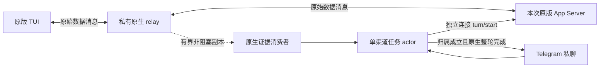

# V3 单会话 Telegram 渠道接入契约草案

> 2026-10-09，Proposed。原生附加候选已通过隔离 P0c；本地源码已接入默认关闭的实验运行入口、本机绑定界面、任务 actor 和文本 API。P1 仍进行中、未验收，P2 必要交互和 P3 真实 Telegram 验收未完成。状态只在 [V3 实施计划](v3-implementation-plan.md)维护。

[文档总索引](README.md) · [候选 ADR 0055](decisions/0055-v3-channel-native-protocol.md) · [原生探针证据](validation/v3-channel-origin-2026-10-09.md)

## 1. 用户结果与边界

本机使用者为一个已有受管原生 Thread 添加一个 Telegram 私聊渠道。Telegram 输入沿用这个 Thread 的上下文，只接收自己发起任务的最终回复及必要交互。本机发起的 Turn 不自动外发；不能证明来源的内容暂扣。

第一阶段不提供 Telegram 会话列表、切换、新建、恢复、群聊、多用户或跨会话调度。精确绑定本机选择的 Thread，不根据 TUI 焦点自动换目标。沿用共享上下文意味着渠道任务的模型回复可能引用本机历史；绑定时明确显示这一事实，不能承诺内容级历史保密过滤。

V2 普通 CLI 启动和只读 `/v1` 保持原契约。渠道能力运行方式须显式启用，使用本次 Run 独占的原版 App Server、原版 remote TUI 和私有 Unix socket。已有普通 Run 没有语义端点时，显示无法附加；不自动停止、迁移或恢复它。实际受测版本与平台按验证记录声明，不把源码研究版本当作安装版二进制来源。

实验入口为 `--channel-ready` 或 `launch.channelReady: true`，默认关闭；保存启动偏好后下次应用启动的新 Run 生效。当前 named profile 不受此模式支持，会明确返回 `channel_profile_unsupported`，不默默改用默认配置。凭证与绑定不在普通启动设置中保存。原生运行部分的增量证据见 [接入记录](validation/v3-channel-runtime-2026-10-09.md)。

## 2. 原生输入与观察

relay 保持数据消息原文；WebSocket 心跳和关闭由两端各自正确完成。捕获副本的解码、持久化、慢消费者或渠道 ACK 不参与转发等待。捕获丢失使渠道失效，原生转发继续。

本机绑定资格包含 `Run epoch + transport epoch + 精确 Thread ID + subscription generation + binding generation`，并有本次 TUI 原生订阅证据。退订后同 UUID 再次订阅会得到新 subscription generation，旧绑定不复活。`thread/read`、loaded 列表、网页用户气泡、ANSI 和 cwd 不能代替订阅证据。独立连接的 `turn/start` 只向已加载线程提交；不通过 `thread/resume` 或原生队列取得资格，避免卸载后恢复或留下冷线程未来任务。

actor 自己串行处理有界任务队列，等待目标可提交条件。忙闲检查不是原子排他：本机输入仍可能抢先进入相同 Turn，届时来源门暂扣自动回复，不能承诺渠道独占。每次真实提交有独立 UUID `clientUserMessageId`，它只用于来源关联，不是原生幂等键。

原生证据按同一连续订阅流处理。要求准确 Thread、Turn 开始、同一个 UserMessage 的 started/completed 及自己的 client ID；任何其他用户 item、生命周期缺失、身份冲突、未知终态或顺序矛盾均关闭该次外发资格。`turn/completed.items` 是摘要，不证明没有本机输入。只有明确 `final_answer` 且成功的原生 `turn/completed` 才释放最终文本；模型响应完成、assistant item 完成和工具结束不代替整轮完成。

生产 attempt 在原生写入前注册且最多提交一次，还必须取得匹配的 Accepted ACK；ACK 晚到时保留结果但不外发，Unknown 不重发。失败终态可以返回 withheld 状态，不无限等待或冒充成功回复。每次资格使用及每个发送分块前比较原子已捕获 sequence 与已解码水位。提交前可在任务期限内等待短暂积压；发送分块前发现积压则保守暂扣，已发送过分块时记录部分投递，不自动补发。发送前的有界等待与再次复验留待后续可靠性验证，不属于本片已实现保证。消费者不等待 RPC、持久化或 Telegram 发送。

## 3. 本机绑定与凭证

配置和绑定仅由现有本机 owner 能力入口执行，要求当前 cookie、正确 Host/Origin 和已有防跨站边界。设备阅读能力不因此获得修改 bot、绑定或目标的权限。生产 API 归入 `/workbench/v1`，不增加旧 `/v1` 控制路由。

服务启动和本机 GET 状态不读取保存的 token，也不因此调用 bot API；只有本机显式 configure 才加载或验证凭证。当前六个 Telegram API 均属于 Application owner 路由。写请求必须包含当前 `instanceId`，使用 JSON，最大正文 2048 字节，未知字段拒绝。

| 方法与路径（前缀 `/workbench/v1/application`） | 请求或结果 |
| --- | --- |
| `GET /telegram` | `{instanceId,channel}`，仅绑定/配置状态、队列数、恢复阶段计数与最近任务静态状态 |
| `POST /telegram/configure` | `{instanceId,token?}`；提供 token 时验证后保存，省略表示明确请求读取已保存凭证 |
| `POST /telegram/pair` | `{instanceId}`；返回 `{instanceId,pairing:{generation,command,expiresInSeconds}}`，命令仅展示在本次本机响应中 |
| `POST /telegram/confirm` | `{instanceId,candidate,runId,threadId,sourceRevision}`；candidate 含完整 generation/botId/userId/chatId，服务端复验来源 revision 和精确资格 |
| `POST /telegram/revoke` | `{instanceId}`；撤销授权、清除排队和旧外发资格 |
| `POST /telegram/forget` | `{instanceId}`；撤销并另行删除保存的凭证 |

除 pair 外，成功写响应与 GET 使用相同状态 envelope。`configured` 表示当前进程已有验证后的 bot client，不表示磁盘没有保存凭证；重启后仍可明确点击加载。`GET /application/channel-runs` 的 `telegramImplemented: true` 只表示代码入口可用，不是 P1/P2/P3 验收标记。

本机面板仅打开时每秒读取状态。token 使用 password 输入，提交后清空，不写浏览器 localStorage；未知写结果不自动重发，暂停轮询并要求手动刷新核对。确认勾选绑定完整 candidate 身份，来源 revision 或候选身份变化不能沿用原确认。必要交互当前明确回本机处理，远端交互仍待 P2。

本机输入 bot token 后，先调用 `getMe` 验证 bot 身份，再检查 `getWebhookInfo`。已有 webhook 时明确停止配置流程，不自动删除或接管 webhook。token 保存在独立私有文件；普通设置、状态 API、错误、Debug、诊断日志和报告均不得回传凭证。目录本人拥有且权限 0700，文件 0600；不跟随符号链接，不接受硬链接、被替换的配置根或并发写者。凭证写入使用临时文件、实际 file fsync、原子替换和 directory fsync。

绑定由本机生成短期、一次性的高熵 nonce。使用者在目标 private chat 向 bot 发送 `/bind <nonce>` 后，本机显示准确 user ID/chat ID，必须由本机确认该候选身份才激活。第一个 `/start`、用户名、转发来源或未知发送者不授予权限。首次 candidate 不读取或发送会话正文。nonce 过期、撤销和复用均拒绝；活动绑定只允许一个 bot、user 和 private chat。

活动绑定不在服务重启后自动恢复。凭证可保留，但重启后须重新完成本机确认及已有 Thread 资格检查。本机撤销立即推进 generation，清除排队输入和待发送内容；已经向 Telegram 发出的内容无法召回。

撤销会使仍等待 HTTP 的旧配置失效，但不回滚已开始的凭证保存。忘记凭证是独立、串行的 forget 操作；配置仍占用写锁时须核对结果后明确执行，不能把撤销成功当作 token 已删除。

## 4. 收件、提交不确定与持久化

渠道收件独立于原生 durable history。最小收件存储仅保留 `bot ID + chat ID + message ID`、update ID、随机 task/client ID、阶段和格式版本；不保留输入正文、reasoning、工具结果或 token。Telegram 的重复 update 或同一消息不产生第二次实际提交，不依靠文本相同或 wall clock 去重。

receipt journal 新写版本为 v2，读取器接受有序的 v1/v2 混合行；v1 不接受新增 Rejected 记录，旧读取器不兼容 v2。接收可执行消息时，先保存收件并实际 fsync，再允许进入渠道队列；原生写入之前保存提交意图并 fsync。拒绝、未激活、旧授权窗口、非任务或未支持 callback 的 update 也须先持久保存拒绝记录并 fsync，才能推进 polling offset。拒绝记录包含 bot/update 身份及能够安全提取时的 message key，参与去重；任何旧窗口消息都不能在随后绑定变化时重新解释为可执行任务。旧请求返回的 batch 按发起 polling 时的授权窗口核对，不借用返回时的新绑定。

| 阶段 | 能证明什么 | 退出或重启后的处理 |
| --- | --- | --- |
| Rejected（v2） | 已持久拒绝该 update/message 身份，不含任务正文 | 不在新绑定窗口重新执行 |
| Received | 已持久收件，尚未证明原生执行 | 不自动重放；旧绑定已失效 |
| Submitting | 已持久登记提交意图，原生可能已收到 | 保留不确定，禁止自动重发 |
| Closed | 收件处理已关闭，包括放弃尚未提交的消息 | 不代表原生成功或 Telegram 送达，不再重放 |
| 原生确认 / 完成 | 由当前连续流取得来源与原生终态证据 | 缺口后不能用历史补齐旧外发资格 |
| Telegram confirmed | bot API 接受某条发送，返回目标 chat/message ID | 不代表已读，也不代表原生整轮完成 |
| Telegram unknown | 请求可能已送达，但无法确认 | 不自动重发；明确显示不确定 |

恢复读取只用于去重和展示已有收件状态，不是 native 命令恢复器。journal 有格式、连续 sequence、摘要和 4 MiB 上限；Received task 与 Rejected update 身份共享总数 4096 的容量，不以独立计数绕过上限。损坏、尾部不完整、身份变化、写入/fsync 失败或达到上限时停止渠道提交，不能清空去重集合来继续。原生 CLI、模型和 PTY 转发继续运行。旧数据库不迁移，不把新收件意图扩展为旧 Session Kernel、ThreadOwner 或 command ledger/CAS。

## 5. 输出与必要交互

P1 当前只发送自己的最终文本；审批、问题等必要交互留在本机 Codex，远端 callback/取消闭环待 P2。下表是 P2 候选契约，不表示已生产支持。初片不外发 reasoning、工具输出、命令 stdout/stderr、diff、历史快照、cwd、终端或全部本机消息。正文按纯文本发送，不设置 `parse_mode`，关闭链接预览；拆分按 UTF-16 限界，不截断代理对，超限/部分发送须明确表达。

发送之前再次检查 binding/Run/transport generation 和任务来源资格。bot API client 禁止 redirect 和自动 retry，响应限制为 1 MiB。明确 API 拒绝可表达 retry-after；5xx、超时、丢 ACK、畸形成功响应或错误目标 chat 视为 unknown，不自动重复发送。接收、原生完成和渠道发送确认分别表达。

| 交互 | 第一阶段候选处理 | 仍需证明 |
| --- | --- | --- |
| 本次渠道任务的 command approval | 明确允许/拒绝，与本机共享原生 first-response-wins；独立连接响应路径已有隔离证据 | 生产请求归属、同时竞速、撤销后迟到 callback |
| 本次渠道任务的 file approval | 明确允许/拒绝 | 文件审批响应路径、生产归属和竞速仍须独立实测 |
| 支持 schema 的 `requestUserInput` | 有界问题/选项与精确回答；独立连接回答阻塞 Plan 问题已有隔离证据 | 生产 task/request/question 归属，过期、重复、已解决与本机抢先 |
| 未支持 approval、MCP 或原生设置/picker | 明确提示回本机完成；不自动默许 | 不外发无关请求正文，不代答客户端独占流程 |
| 取消 | 仅针对当前已归属渠道 task，并经准确 native Turn ID 检查 | 不得中断混入本机输入的 Turn；API 不确定不能伪装已取消 |

callback 数据只携带有界 opaque reference。actor 必须核对绑定身份、bot、原始私聊消息、generation、task、native request、期限和一次性消费；callback ACK 只停止 Telegram spinner，不等于执行授权成功。原生 `serverRequest/resolved` 使旧按钮失效。P0c 已验证独立连接回答命令审批和阻塞 Plan 问题；文件审批和生产 callback 规则仍须实测，不能因观察到请求便宣称所有请求可回答。

官方只读源码 `2351d9e1b608e6f9d9a3699b71d7eb39ee41cfa4` 的 [callback 路由](https://github.com/openai/codex/blob/2351d9e1b608e6f9d9a3699b71d7eb39ee41cfa4/codex-rs/app-server/src/outgoing_message.rs#L568)只对 MCP UserVerification 限制响应连接，普通请求可以由独立控制连接回答。但原生 callback 在解析 typed answer 之前已被消费，是 first raw response/error wins；必须严格构造已知 schema，不能发送占位或试探响应。响应没有应用层 ACK，resolved 也可能由本机回答或取消产生，不能当作 Telegram 决定获胜的证明。具体组合以安装版实测为准，未知和客户端独占请求留在本机。

## 6. 原生退出与同 HOME 启动边界

仅 opt-in App Server 设置 `thread_unload_delay_secs=0`，不修改普通 V2 CLI 或用户原生配置文件。停止时先使控制与外发失效、关闭本 Run relay，再向核验后的单个 native peer 发 SIGTERM；有限时间内尝试原生 interrupt/后台终端清理，超时只回收本 Run 独占组，不扫描全机 PPID。socket 清理只针对归属和 inode 匹配的物理叶子，保留官方共享目录。

`NativeExited` 只表示核验的 native peer 消失、拥有的 wrapper 正常退出并回收，且没有使用强制 fallback；不承诺原生工具、派生/独立进程组或异步终止的工具全部结束。Application 据此解除当前同 HOME 启动门，是有限的原生生命周期决定。`ForcedUnknown` 保留同 HOME 启动门；关闭仍进行时拒绝立即重开。不能把重启应用、固定等待、重复 `loaded=[]` 或正常 exit code 当作所有工具结束的证明。

正常宿主退出已实现并行停止 TUI、启动各 Run 原生回收并等待同一 ShutdownHandle；等待期间保留活动 Run 的 proxy/runtime，未发布 Owner 的取消或失败也执行 Drop 等待。统一 18 秒只约束 reaper 阶段的等待策略，不是整个 Application Drop 的硬上限。真实单 Run normal/forced 场景及取消路径取得增量证据，最终增强 witness 断言的宿主退出专项与 Owner lifecycle 专项已通过；不据此宣称多个真实 Run 并发退出或所有工具回收已验收。

## 7. 失效与验收

Run 退出、目标卸载/退订、TUI 协议断线、连接 epoch 变化、解析缺口、捕获溢出、绑定撤销或目标更换都使旧任务和待外发内容失效。TUI 焦点是原生客户端内部状态，本方案不承诺探测每次焦点切换，也不将焦点切换当作自动换绑命令。

P1 应交付可操作的本机配置/绑定/撤销与同一 Thread 文本闭环；P2 补齐上述明确支持交互及失效矩阵。合成 bot API 证明身份负例、重复消息、发送不确定、慢发送、慢存储和存储故障；安装版原生 CLI 证明严格已加载输入、来源连续性和不阻塞转发。最后由使用者配置自己的凭证，完成真实 Telegram 上下文、本机来源隔离和必要交互验收。合成结果和只读报告页不代替生产或跨设备验收。
