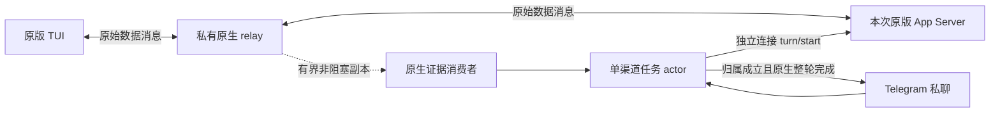

# V3 单会话 Telegram 渠道接入契约草案

> 2026-10-09，Proposed。原生附加候选已通过隔离 P0c；本地源码已接入默认关闭的实验运行入口、本机绑定界面、任务 actor 和文本 API。P1 仍进行中、未验收，P2 必要交互和 P3 真实 Telegram 验收未完成。状态只在 [V3 实施计划](v3-implementation-plan.md)维护。

[文档总索引](README.md) · [候选 ADR 0055](decisions/0055-v3-channel-native-protocol.md) · [原生探针证据](validation/v3-channel-origin-2026-10-09.md)

## 1. 用户结果与边界

本机使用者为一个已有受管原生 Thread 添加一个 Telegram 私聊渠道。Telegram 输入沿用这个 Thread 的上下文，只接收自己发起任务的最终回复及必要交互。本机发起的 Turn 不自动外发；不能证明来源的内容暂扣。

第一阶段不提供 Telegram 会话列表、切换、新建、恢复、群聊、多用户或跨会话调度。精确绑定本机选择的 Thread，不根据 TUI 焦点自动换目标。沿用共享上下文意味着渠道任务的模型回复可能引用本机历史；绑定时明确显示这一事实，不能承诺内容级历史保密过滤。

V2 普通 CLI 启动和只读 `/v1` 保持原契约。渠道能力运行方式须显式启用，使用本次 Run 独占的原版 App Server、原版 remote TUI 和私有 Unix socket。已有普通 Run 没有语义端点时，显示无法附加；不自动停止、迁移或恢复它。实际受测版本与平台按验证记录声明，不把源码研究版本当作安装版二进制来源。

实验入口为 `--channel-ready` 或 `launch.channelReady: true`，默认关闭；保存启动偏好后下次应用启动的新 Run 生效。当前 named profile 不受此模式支持，会明确返回 `channel_profile_unsupported`，不默默改用默认配置。凭证与绑定不在普通启动设置中保存。原生运行部分的增量证据见 [接入记录](validation/v3-channel-runtime-2026-10-09.md)。

## 2. 原生输入与观察

relay 保持数据消息原文；WebSocket 心跳和关闭由两端各自正确完成。捕获副本的解码、持久化、慢消费者或渠道 ACK 不参与转发等待。捕获丢失使渠道失效，原生转发继续。

本机绑定资格包含 `Run epoch + transport epoch + 精确 Thread ID + subscription generation + binding generation`，并有本次 TUI 原生订阅证据。退订后同 UUID 再次订阅会得到新 subscription generation，旧绑定不复活。`thread/read`、loaded 列表、网页用户气泡、ANSI 和 cwd 不能代替订阅证据。独立连接的 `turn/start` 只向已加载线程提交；不通过 `thread/resume` 或原生队列取得资格，避免卸载后恢复或留下冷线程未来任务。

普通 `source` 仍不足以证明用户用途：订阅请求及成功响应中的 `ephemeral` 仅允许缺省、null 或 false，`threadSource` 仅允许缺省、null 或 `user`；显式临时、后台 feature/subagent 等用途或畸形类型不授予候选。缺省兼容旧公共协议，不按请求 ID 前缀猜测用途。排除 ACK 撤销同 UUID 的既有资格，并清空 pending 订阅，迟到旧 ACK 不能恢复；同时进行的普通订阅也可能被保守取消，须由后续新请求及 ACK 重新建立资格。

全部 TUI 客户端带 ID 请求共用累计 256 项、永不驱逐的 RPC 身份预算，包括普通 read/turn 请求；无 ID 通知和无 method 的客户端响应不计入。重复、畸形 ID 或容量耗尽关闭该 Run 渠道资格，原始转发继续。此实验上限可能限制长 Run，不通过清除身份记录或重用旧绑定继续运行。

actor 自己串行处理有界任务队列，等待目标可提交条件。忙闲检查不是原子排他：本机输入仍可能抢先进入相同 Turn，届时来源门暂扣自动回复，不能承诺渠道独占。每次真实提交有独立 UUID `clientUserMessageId`，它只用于来源关联，不是原生幂等键。

原生证据按同一连续订阅流处理。要求准确 Thread、Turn 开始、同一个 UserMessage 的 started/completed 及自己的 client ID；任何其他用户 item、生命周期缺失、身份冲突、未知终态或顺序矛盾均关闭该次外发资格。`turn/completed.items` 是摘要，不证明没有本机输入。只有明确 `final_answer` 且成功的原生 `turn/completed` 才释放最终文本；模型响应完成、assistant item 完成和工具结束不代替整轮完成。

生产 attempt 在原生写入前注册且最多提交一次，还必须取得匹配的 Accepted ACK；ACK 晚到时保留结果但不外发，Unknown 不重发。失败终态可以返回 withheld 状态，不无限等待或冒充成功回复。每次资格使用及每个发送分块前比较原子已捕获 sequence 与已解码水位。提交前可在任务期限内等待短暂积压；发送分块前发现积压则保守暂扣，已发送过分块时记录部分投递，不自动补发。发送前的有界等待与再次复验留待后续可靠性验证，不属于本片已实现保证。消费者不等待 RPC、持久化或 Telegram 发送。

## 3. 本机绑定与凭证

配置和绑定仅由现有本机 owner 能力入口执行，要求当前 cookie、正确 Host/Origin 和已有防跨站边界。设备阅读能力不因此获得修改 bot、绑定或目标的权限。生产 API 归入 `/workbench/v1`，不增加旧 `/v1` 控制路由。

服务启动和本机 GET 状态不读取保存的 token，也不因此调用 bot API；只有本机显式 configure 才加载或验证凭证。当前六个 Telegram API 均属于 Application owner 路由。写请求必须包含当前 `instanceId`，使用 JSON，最大正文 2048 字节，未知字段拒绝。

| 方法与路径（前缀 `/workbench/v1/application`） | 请求或结果 |
| --- | --- |
| `GET /telegram` | `{instanceId,channel}`，仅绑定/配置状态、队列数、恢复阶段计数与最近任务静态状态 |
| `POST /telegram/configure` | `{instanceId,token?}`；提供 token 时验证后保存，省略表示明确请求读取已保存凭证 |
| `POST /telegram/pair` | `{instanceId}`；返回 `{instanceId,pairing:{generation,command,expiresInSeconds}}`，命令仅展示在本次本机响应中 |
| `POST /telegram/confirm` | `{instanceId,candidate,runId,threadId,sourceRevision,interactiveConsent?}`；交互授权仅接受 boolean，缺省 false；candidate 含完整 generation/botId/userId/chatId，服务端复验来源 revision 和精确资格 |
| `POST /telegram/revoke` | `{instanceId}`；撤销授权、清除排队和旧外发资格 |
| `POST /telegram/forget` | `{instanceId}`；撤销并另行删除保存的凭证 |

除 pair 外，成功写响应与 GET 使用相同状态 envelope。`configured` 表示当前进程已有验证后的 bot client，不表示磁盘没有保存凭证；重启后仍可明确点击加载。`GET /application/channel-runs` 的 `telegramImplemented: true` 只表示代码入口可用，不是 P1/P2/P3 验收标记。

本机面板仅打开时每秒读取状态。token 使用 password 输入，提交后清空，不写浏览器 localStorage；未知写结果不自动重发，暂停轮询并要求手动刷新核对。共享上下文与必要交互使用独立勾选；candidate 身份、目标、来源 revision 或 instance 变化不能沿用原确认。活动快照明确返回 `interactiveConsent`，重新绑定或重启不继承交互授权。未授权或未支持的必要交互回本机处理。

本机输入 bot token 后，先调用 `getMe` 验证 bot 身份，再检查 `getWebhookInfo`。已有 webhook 时明确停止配置流程，不自动删除或接管 webhook。token 保存在独立私有文件；普通设置、状态 API、错误、Debug、诊断日志和报告均不得回传凭证。目录本人拥有且权限 0700，文件 0600；不跟随符号链接，不接受硬链接、被替换的配置根或并发写者。凭证写入使用临时文件、实际 file fsync、原子替换和 directory fsync。

绑定由本机生成短期、一次性的高熵 nonce。使用者在目标 private chat 向 bot 发送 `/bind <nonce>` 后，本机显示准确 user ID/chat ID，必须由本机确认该候选身份才激活。第一个 `/start`、用户名、转发来源或未知发送者不授予权限。首次 candidate 不读取或发送会话正文。nonce 过期、撤销和复用均拒绝；活动绑定只允许一个 bot、user 和 private chat。

活动绑定不在服务重启后自动恢复。凭证可保留，但重启后须重新完成本机确认及已有 Thread 资格检查。本机撤销立即推进 generation，清除排队输入和待发送内容；已经向 Telegram 发出的内容无法召回。

撤销会使仍等待 HTTP 的旧配置失效，但不回滚已开始的凭证保存。忘记凭证是独立、串行的 forget 操作；配置仍占用写锁时须核对结果后明确执行，不能把撤销成功当作 token 已删除。

## 4. 收件、提交不确定与持久化

渠道收件独立于原生 durable history。最小收件存储仅保留 `bot ID + chat ID + message ID`、update ID、随机 task/client ID、阶段和格式版本；不保留输入正文、reasoning、工具结果或 token。Telegram 的重复 update 或同一消息不产生第二次实际提交，不依靠文本相同或 wall clock 去重。

receipt journal 新写版本为 v5，读取器接受有序的 v1/v2/v3/v4/v5 混合行；v1 不接受 Rejected，v1/v2 不接受 CallbackReceived，v1/v2/v3 不接受 QuestionReplyReceived，v1–v4 不接受 QueuedCanceled。旧读取器不兼容 v5；历史合法收件不因新增交互索引被拒绝，不重写旧文件。接收可执行消息时，先保存收件并实际 fsync，再允许进入渠道队列；原生写入之前保存提交意图并 fsync。拒绝、未激活、旧授权窗口、非任务或未支持 callback 的 update 也须先持久保存拒绝记录并 fsync，才能推进 polling offset。拒绝记录包含 bot/update 身份及能够安全提取时的 message key，参与去重；任何旧窗口消息都不能在随后绑定变化时重新解释为可执行任务。旧请求返回的 batch 按发起 polling 时的授权窗口核对，不借用返回时的新绑定。

有效 callback 保存 `bot ID + update ID + query ID 的 BLAKE3 摘要 + task UUID + interaction UUID`，在实际 fsync 之后才允许更新问题选择或尝试原生回答。原始 query ID、按钮 reference、动作、问题/命令/路径正文及原生 RPC ID 不入 journal。bot/update 与 bot/query 摘要分别去重，不把提示消息 ID 当作原始任务 message key。任务须仍处于同 bot 的 Submitting；callback 收件不代表 native answer 已写入或被采纳。重启仅保留去重与任务阶段计数，不恢复按钮、问题选择或回答。

有效文字回答保存 `bot ID + chat ID + 用户回复 message ID + update ID + task UUID + interaction UUID`，同样先实际 fsync，再更新选择或尝试回答；不保存回答、被回复正文、提示 ID 或原生 RPC ID。task 须仍处于相同 bot/chat 的 Submitting，回答的 update/message 身份与任务、拒绝和 callback 共用去重域。收件不能证明原生采纳，恢复不能重放回答或还原问题授权。

当前 Service 在领取任何审批、问题或取消引用之前，先在短内存锁中保留输入身份，再异步查询全部已消费域：Received、Rejected、CallbackReceived、QuestionReplyReceived 与 QueuedCanceled 的 bot/update，全部消息 key，以及 bot/query 摘要。冲突输入不消费当前提示，不追加记录，也不学习其另一个身份。提示消息 ID 不作为用户消息 key。查询只做去重，不能授予当前授权；后续仍复验绑定、来源和准确引用，实际收件写者仍执行原有原子校验。该入口比历史 Received 写入规则更保守，不更改旧 journal 回放校验或格式。

输入身份最多保留 17 项，包含随机独立 owner、bot/update、可安全提取的 message key 和固定 32 字节 query 摘要；没有正文、按钮引用或原始 query。仅该 owner 的正常处理返回释放身份；错误、调用取消或丢失调用者均保守保留至 Service 结束，撤销或重新配置不清空。容量满时停止渠道并报告 `channel_input_capacity`，需要重新启动服务、重新确认绑定；不淘汰旧身份来继续，不阻塞原生转发。这个入口保留与取消引用的内部保留分别有界，不恢复任何执行权限。

| 阶段 | 能证明什么 | 退出或重启后的处理 |
| --- | --- | --- |
| Rejected（v2） | 已持久拒绝该 update/message 身份，不含任务正文 | 不在新绑定窗口重新执行 |
| Received | 已持久收件，尚未证明原生执行 | 不自动重放；旧绑定已失效 |
| Submitting | 已持久登记提交意图，原生可能已收到 | 保留不确定，禁止自动重发 |
| CallbackReceived（v3） | 已持久接收该 callback 身份 | 不重放原生回答，不恢复交互授权 |
| QuestionReplyReceived（v4） | 已持久接收文字回答的消息身份 | 不保存正文，不重放回答或恢复问题授权 |
| QueuedCanceled（v5） | 取消输入身份已保存，目标 Received 在同一行原子关闭 | 不保存取消引用，不重放命令，不恢复取消资格 |
| Closed | 收件处理已关闭，包括放弃尚未提交的消息 | 不代表原生成功或 Telegram 送达，不再重放 |
| 原生确认 / 完成 | 由当前连续流取得来源与原生终态证据 | 缺口后不能用历史补齐旧外发资格 |
| Telegram confirmed | bot API 接受某条发送，返回目标 chat/message ID | 不代表已读，也不代表原生整轮完成 |
| Telegram unknown | 请求可能已送达，但无法确认 | 不自动重发；明确显示不确定 |

恢复读取只用于去重和展示已有收件状态，不是 native 命令恢复器。journal 有格式、连续 sequence、摘要和 4 MiB 上限；Received task、Rejected update、CallbackReceived、QuestionReplyReceived 和 QueuedCanceled 身份共享总数 4096 的容量，不以独立计数绕过上限。损坏、尾部不完整、身份变化、写入/fsync 失败或达到上限时停止渠道提交，不能清空去重集合来继续。原生 CLI、模型和 PTY 转发继续运行。旧数据库不迁移，不把新收件意图扩展为旧 Session Kernel、ThreadOwner 或 command ledger/CAS。

## 5. 输出与必要交互

P1 只发送自己的最终文本；P2 本地源码已接入显式授权后的普通命令审批、有完整范围的文件审批及有界非秘密选项/文字问题，整体未验收。下表列明已接入边界和剩余证明；独立排队取消已接入本地源码，精确整轮取消与真实 Telegram 验收未完成。不外发 reasoning、工具输出、命令 stdout/stderr、diff、历史快照、cwd、终端或全部本机消息。正文按纯文本发送，不设置 `parse_mode`，关闭链接预览；拆分按 UTF-16 限界，不截断代理对，超限/部分发送须明确表达。

发送之前再次检查 binding/Run/transport generation 和任务来源资格。bot API client 禁止 redirect 和自动 retry，响应限制为 1 MiB。明确 API 拒绝可表达 retry-after；5xx、超时、丢 ACK、畸形成功响应或错误目标 chat 视为 unknown，不自动重复发送。接收、原生完成和渠道发送确认分别表达。

| 交互 | 当前本地实现及证据 | 仍需证明 |
| --- | --- | --- |
| 本次渠道任务的 command approval | 原生单次动作交集，共享 first raw response/error wins；生产原版 CLI 允许链路及合成迟到 callback 负例通过 | 真实 Telegram 与本机实际同时操作、安装版其他命令范围 |
| 本次渠道任务的 file approval | 展示完整有界路径与操作，明确允许/拒绝；安装版单文件 Add 允许/拒绝/竞争探针及生产拒绝链路通过 | 多文件、删除、更新和 rename 的生产操作链与真实 Telegram |
| 支持 schema 的 `requestUserInput` | 有界非秘密问题、单题提示、选项及显式 Reply 文字回答；先逐题收件再一次写完整答案，合成过期/重复/本机退休负例通过 | 原版 CLI 生产多题/Other 路径的本片专项结果见新增记录；真实 Telegram 与人的同时输入、无选项问题的实际原生生产来源仍须验证 |
| 未支持 approval、MCP 或原生设置/picker | 明确提示回本机完成；不自动默许 | 不外发无关请求正文，不代答客户端独占流程 |
| 取消 | 已确认等待提示中的 `/cancel <reference>` 只取消尚未取得提交权的准确任务；本机撤销清除渠道排队 | 提交权已取得时拒绝取消；已提交任务的精确整轮取消保持未完成，不以撤销输出冒充已取消 |

callback 数据只携带有界 opaque reference。actor 必须核对绑定身份、bot、原始私聊消息、generation、task、native request、期限和一次性消费；callback ACK 只停止 Telegram spinner，不等于执行授权成功。原生 `serverRequest/resolved` 使旧按钮失效。P0c 已验证独立连接回答命令审批和阻塞 Plan 问题；[P2 原生探针](validation/v3-channel-interactions-2026-10-09.md)补证单文件 Add 允许/拒绝/竞争及问题负例。[生产接入记录](validation/v3-channel-callbacks-2026-10-09.md)补证命令允许与单文件 Add 拒绝；[文字回答记录](validation/v3-channel-question-replies-2026-10-09.md)补证原版 CLI 的混合多题操作链及其工具配置/声明限制。以上使用合成 Bot/model；真实 Telegram、其他文件范围与真实模型仍须实测，不能因观察到请求便宣称所有请求可回答。

官方只读源码 `2351d9e1b608e6f9d9a3699b71d7eb39ee41cfa4` 的 [callback 路由](https://github.com/openai/codex/blob/2351d9e1b608e6f9d9a3699b71d7eb39ee41cfa4/codex-rs/app-server/src/outgoing_message.rs#L568)只对 MCP UserVerification 限制响应连接，普通请求可以由独立控制连接回答。但原生 callback 在解析 typed answer 之前已被消费，是 first raw response/error wins；必须严格构造已知 schema，不能发送占位或试探响应。响应没有应用层 ACK，resolved 也可能由本机回答或取消产生，不能当作 Telegram 决定获胜的证明。具体组合以安装版实测为准，未知和客户端独占请求留在本机。

### 5.1 P2 的本机授权与实时来源门

P2 本机激活时另行明确确认 `interactiveConsent`，默认 false，不将共享上下文确认解释为允许发送必要命令、文件名和问题正文。该授权只随当前 binding generation 生效，不保存或在重启后恢复；改变 candidate、目标或 revision 会清空界面勾选。

必要交互要求匹配 Accepted 的 Turn ID、该 Turn 的 started、同一个渠道 user item 的 started/completed，以及准确 request 的 Thread/Turn/item。`OriginProof.live_owned_turn()` 只证明当前来源；它不授予回答任意 RPC 的权限。ACK 迟到时可以有界保留候选请求，但不得先发送提示或答复。混入本机输入、终态、撤销、退订、epoch 变化、观察缺口或捕获水位领先解码水位时，旧交互失效。

本机客户端对同一个原生 request ID 发出 result 或 error 时，立即撤销远端资格，不等待 resolved。numeric ID 与 string ID 保持不同；原生 RPC request ID、item ID、approvalId 和 question ID 不互相替代。发送提示和写入答复前均复验来源、水位、请求状态和 binding generation；这些检查仍允许原生两客户端同时回答，由原生消费首个 raw response/error。

### 5.2 必要内容与 typed answer

- 命令审批只支持已识别的普通 command 和本次单次 accept/decline，按钮是原生 availableDecisions 与这两个动作的交集；原生未提供 decline 时不自行加拒绝按钮，也不以 cancel 替代。环境仅允许缺省/null 或原生保留标识 `local`，其他环境回本机。展示有界 command、reason 和实际权限含义，不外发 cwd、stdout/stderr、环境变量或完整附加权限对象。已知且通过有界 schema 检查的持久策略提议可作为原生替代选项存在，但渠道不展示或选择这些选项；普通 accept 仍只答本次审批。实际网络授权、额外权限、writeStdin、远程环境授权、会话授权及未知 schema 回本机处理，不以普通按钮降格表达。
- 文件审批必须先观察同一 Thread/Turn/item 的完整 `item/started(fileChange)`。只保留有界 path、kind 和 rename 的目标路径，解析时丢弃 diff。无完整范围、未知操作、冲突、超限或提示后范围变化时，不提供远端 accept。`grantRoot != null` 是更广范围授权，禁止远端 accept，不能显示为单次文件修改。
- `requestUserInput` 只处理 1–3 个阻塞问题，每题可有 2–4 个选项；缺省/null/空 options 按公共协议识别为文字题。有选项且 `isOther=true` 时允许文字回答，`isOther=false` 时只允许选项；任一题 `isSecret=true`、非阻塞、定时或未知 schema 均回本机。问题、选项和答案关联完整原始 request 身份及 question ID；拒绝重复 ID、未知 ID、未知字段和超限，不构造部分答案或占位空回答。每次只确认发送并激活一题，前题收件 fsync 后才发送下一题；所有题完成后只写一个完整 typed answer。
- 文字必须由已绑定 user 在准确 private chat 中，通过 Telegram Reply 回复当前已确认发送的 bot 单题消息。核对被回复消息的准确 bot/chat/message、可访问日期、当前 generation、task、request、期限与原生来源；转发、外部引用、quote、编辑或其他 bot 回复不授予资格。不读被回复正文建立权限；未附着文字、旧题或无效回复不能排成新任务。文字和同题按钮共享一次性资格，在任何持久化 await 前取走全部引用；本机回答、resolved、终态、撤销或缺口继续使其失效。纯文字题使用 [ForceReply](https://core.telegram.org/bots/api#forcereply)，有选项题保留按钮并说明显式 Reply 用法。
- 文字答案最多 1024 UTF-16 单元及 4096 UTF-8 字节，trim 后不得为空；只允许换行作为控制字符，拒绝 TAB、NUL、ANSI 与 bidi 控制。保留原始空白、Unicode 和换行，不把文字解释为命令。原生结果按原 question ID 使用 `answers: [原始文字]`，不添加 TUI 内部 `user_note:` 或 `None of the above`。这是本项目基于公开 typed schema 的选择；当前正常模型工具要求非空 options 且自动设置 isOther，因此无选项题只有协议/合成覆盖，不能宣称安装版模型路径已验证。

每个 attempt 累计最多 32 个原生请求身份及 32 个完整文件范围，身份不驱逐复用；每个文件范围最多 8 个路径操作。远端回答授权期限为观察后十分钟，仍受任务三十分钟期限限制。按钮过期或回答写入不能证明原生追问已解决，文本分流保护等待准确本机 result/error、resolved、item/Turn 终态或 attempt 失效。重复原生 ID、冲突范围或容量耗尽只关闭交互资格，不伪造回答或阻断原生转发，也不自行污染最终回复来源证明。未知请求只提供有界静态本机提示。

文本分流门在原生 submit 之前登记，ACK 或完整渠道用户来源证明未齐时拒绝文本入队，不先发送交互。提交 Unknown 或未决/不确定交互退出时，仅使该任务准确 generation/target 的旧绑定失效，清除其排队与引用，保留 uncertain 收件；不能撤销已替换的新绑定。继续需在本机核对并重新确认可用目标，失效渠道不阻断原生 TUI。

文件顺序有固定源码、schema 和测试依据：[apply_patch handler](https://github.com/openai/codex/blob/2351d9e1b608e6f9d9a3699b71d7eb39ee41cfa4/codex-rs/core/src/tools/handlers/apply_patch.rs#L531)先发完整 begin，再进入审批 orchestrator；[tool events](https://github.com/openai/codex/blob/2351d9e1b608e6f9d9a3699b71d7eb39ee41cfa4/codex-rs/core/src/tools/events.rs#L242)将其发为完整 FileChange item；[App Server 测试](https://github.com/openai/codex/blob/2351d9e1b608e6f9d9a3699b71d7eb39ee41cfa4/codex-rs/app-server/tests/suite/v2/turn_start.rs#L3866)核对 item 在 approval 前且身份相同。`patchUpdated` 可以是流式解析预览，不能单独替代完整 started。安装版单文件 Add 已补证该顺序；原版 CLI 加生产 Application 的混合 Add/Update/Delete/Move 拒绝与允许、准确文件结果已有[增量专项](validation/v3-channel-p2-acceptance-2026-10-10.md)证据。更广 grantRoot、其他范围和真实 Telegram 仍须独立实测，不能从该专项推断全部审批已验收。

### 5.3 callback 与响应结果

只有 Telegram 发送确认返回准确 chat/message ID 后，才激活提示中的 opaque reference；未知或部分投递不激活按钮。回调须匹配原 bot/user/chat/message、binding generation、task、准确原生 request、动作和期限，并只能消费一次。迟到、重复、发送确认前或本机已回答的 callback 不写入原生。callback ACK 只结束 spinner。

独立连接只写入已验证的 typed result，不提供通用 RPC 或 JSON-RPC error 兜底。结果区分 `NotSent`、`WrittenUnconfirmed` 和 `Unknown`；写成功不表示原生采纳，更不表示操作成功。resolved 只撤销旧请求，最终工具/Turn 结果与 Telegram 投递分别记录。不自动重试未知响应，也不在重启后重放 callback。CallbackReceived 只是无正文收件证据，Rejected 不能描述为交互成功。

控制 actor 先等待 WebSocket 就绪，再同步复验授权、原子捕获水位和请求状态，随即 `start_send`，两者之间没有 await。`start_send` 接纳是不可撤回的尝试边界；它可能只把字节放入传输缓冲区。该边界之前的撤销或本机回答阻止新 envelope，之后无法保证已接纳的字节不会在撤销后 flush。超时或传输失败归为 Unknown，不自动重发；不能宣称撤销能够收回在途原生回答。

原版 TUI 文件菜单的 No/Esc 在研究源码中是 Cancel，不等同本渠道的单项 Deny。[有序审批专项](validation/v3-channel-tui-order-2026-10-10.md)使用安装版实际菜单和 PTY，验证本机先允许后的旧渠道拒绝，以及渠道先拒绝后的准确文件结果与当前菜单退场；它不使用本机 Cancel，也不证明双方真正同时响应、获胜端身份或内部菜单对象状态。

[已准入回答专项](validation/v3-channel-tui-inflight-2026-10-10.md)补充一个可确定的重叠边界：测试专用独立控制写屏障在 fresh validate 之后、start_send 之前同步激活，成功准入而实际零写出时，真实 TUI 允许先完成准确文件操作；随后释放已准入的迟到 Decline，工具结果保持一次。探针只观察本次 typed ID 元数据，不授予权限；relay 的 raw Accept 捕获只证明生成，实际工具成功及零渠道写入才构成因果证据。WrittenUnconfirmed 和 resolved 均不升级为原生采纳/获胜端 ACK，也不将这一控制交错扩称为所有同时操作已验证。

### 5.4 独立排队取消

目标忙碌或前面还有渠道任务时，后台发送静态等待提示及随机 32 位小写十六进制引用。前一任务已原生完成、但执行器仍等待最终发送确认或收件收尾时，新任务也属于等待范围；内存占用标记保留到该执行器收尾，撤销不会清除尚未结束的占用，也不因此恢复旧授权。仅 bot API 确认准确私聊消息后才激活引用。绑定使用者在原私聊直接发送准确 `/cancel <reference>`；转发、编辑、via-bot、Reply、外部引用、错误身份、旧 generation、超期或未确认引用不能授权取消。Reply 仍按当前问题处理，文字中的命令不改变答案含义。取消不要求远程审批授权，不读取或回传任务正文。

取消与提交在同一内存锁中竞争：这两条路径只能从 Open 取得 CancelReserved 或 SubmitClaimed，普通结束另有 Finished 状态。提交先取得权时，在提交意图 fsync 之前就关闭引用；取消先取得权时，移除排队正文，已弹出的等待 actor 也不得提交。准确 task 的 QueuedCanceled 将输入去重与 Received→Closed 合并为一次 append+实际 fsync，成功后才发送静态取消确认。未知、失败或丢失返回都不恢复 Open，不谎称取消成功；取消路径自己拥有关闭权，执行器不得另写 Closed。执行器按每个任务的明确收件结果决定是否关闭，不用全局最近任务状态判断不确定性。

持久去重查询只用于防止已消费输入夺走另一个引用；查询之后重新验证完整资格，再在锁内保留当前输入身份。最多 17 个在途身份；撤销清除权限和待发内容，但在途去重身份保留到结果返回，丢失调用者的身份保守保留至服务结束。引用与提示/确认 outbox 各最多 17 项，由一个受管发送 worker 处理，最多一个 HTTP 在途请求；polling 和 native actor 不等待该发送。确定未尝试的提示可在短暂观察积压解除后重新提供，已尝试但未知的发送不自动重试。提示失效及服务重启不恢复取消权。

QueuedCanceled 仅保存取消输入的 bot/chat/message/update 身份和准确 task UUID；目标仍须属于相同 bot/chat 的 Received。与全部其他收件类型共用去重及容量；恢复只统计 Closed 和去重，不恢复正文或引用。此路径不发送原生 interrupt，不取消已提交的 Turn。安装版与并发验证见[排队取消记录](validation/v3-channel-queue-cancel-2026-10-09.md)，真实 Telegram 仍待验收。

### 5.5 已提交 Turn 的取消缺口

固定源码的 [turn/interrupt handler](https://github.com/openai/codex/blob/2351d9e1b608e6f9d9a3699b71d7eb39ee41cfa4/codex-rs/app-server/src/request_processors/turn_processor.rs#L1610)先检查 Turn ID，再异步记录请求并提交不带 Turn ID 的 Interrupt。检查之后发生本机 Turn 切换时，不能证明不会中断新任务。approval 的 `cancel` 也不是安全替代：[approval response](https://github.com/openai/codex/blob/2351d9e1b608e6f9d9a3699b71d7eb39ee41cfa4/codex-rs/app-server/src/bespoke_event_handling.rs#L1926)经异步路径转换为 Abort，[core handler](https://github.com/openai/codex/blob/2351d9e1b608e6f9d9a3699b71d7eb39ee41cfa4/codex-rs/core/src/session/handlers.rs#L200)中断当前任务，未用该审批的 Turn ID 限定目标。

因此 command/file decline 只表示拒绝该操作；撤销渠道只停止后续渠道处理和外发，原生任务可能继续。问题 error 或畸形 typed answer 会消费 callback 并生成空答案，不能用于取消。不得锁住或阻断原版 TUI 转发来制造互斥，也不得伪造模型错误。精确整轮取消保持明确未完成项；上述源码结论不能由单次竞态测试通过消除。

## 6. 原生退出与同 HOME 启动边界

仅 opt-in App Server 设置 `thread_unload_delay_secs=0`，不修改普通 V2 CLI 或用户原生配置文件。停止时先使控制与外发失效、关闭本 Run relay，再向核验后的单个 native peer 发 SIGTERM；有限时间内尝试原生 interrupt/后台终端清理，超时只回收本 Run 独占组，不扫描全机 PPID。socket 清理只针对归属和 inode 匹配的物理叶子，保留官方共享目录。

`NativeExited` 只表示核验的 native peer 消失、拥有的 wrapper 正常退出并回收，且没有使用强制 fallback；不承诺原生工具、派生/独立进程组或异步终止的工具全部结束。Application 据此解除当前同 HOME 启动门，是有限的原生生命周期决定。`ForcedUnknown` 保留同 HOME 启动门；关闭仍进行时拒绝立即重开。不能把重启应用、固定等待、重复 `loaded=[]` 或正常 exit code 当作所有工具结束的证明。

正常宿主退出已实现并行停止 TUI、启动各 Run 原生回收并等待同一 ShutdownHandle；等待期间保留活动 Run 的 proxy/runtime，未发布 Owner 的取消或失败也执行 Drop 等待。统一 18 秒只约束 reaper 阶段的等待策略，不是整个 Application Drop 的硬上限。真实单 Run normal/forced 场景及取消路径取得增量证据，最终增强 witness 断言的宿主退出专项与 Owner lifecycle 专项已通过；不据此宣称多个真实 Run 并发退出或所有工具回收已验收。

## 7. 失效与验收

Run 退出、目标卸载/退订、TUI 协议断线、连接 epoch 变化、解析缺口、捕获溢出、绑定撤销或目标更换都使旧任务和待外发内容失效。TUI 焦点是原生客户端内部状态，本方案不承诺探测每次焦点切换，也不将焦点切换当作自动换绑命令。

P1 应交付可操作的本机配置/绑定/撤销与同一 Thread 文本闭环；P2 补齐上述明确支持交互及失效矩阵。合成 bot API 证明身份负例、重复消息、发送不确定、慢发送、慢存储和存储故障；安装版原生 CLI 证明严格已加载输入、来源连续性和不阻塞转发。最后由使用者配置自己的凭证，完成真实 Telegram 上下文、本机来源隔离和必要交互验收。合成结果和只读报告页不代替生产或跨设备验收。

Run 移除、关闭/退订请求和畸形 JSON 的 Service 增量回归见[验收记录](validation/v3-channel-p2-acceptance-2026-10-10.md#3-service-失效入口)。退订请求发出即保守失效，不能以迟到响应重新授予旧资格；解析失败保留转发字节并暂扣旧渠道 final。各层证据按该记录的边界组合，不宣称完整故障或实际同时响应矩阵已通过。

[输入身份与重新绑定专项](validation/v3-channel-input-rebind-2026-10-10.md)覆盖重复身份不消费当前提示，以及同一原版 Thread 的撤销后恢复：旧原生审批仍可由本机完成，新绑定任务等待后继续同一上下文，旧输入和旧 final 不外发。它没有进程/Service 重启、传输重连或旧 actor 清理与确认竞争，不替代完整故障矩阵和真实 Telegram 验收。

[Service 重建专项](validation/v3-channel-service-restart-2026-10-10.md)补充真实 Service Drop、独立写者锁释放、显式加载保存凭证、重新配对授权和正常新任务；Session/transport 为连续合成来源，不是安装版 CLI/宿主进程重启。另一个生产 offer 回归检查不支持交互的静态提示：当前归属且明确授权时最多一次，外来/撤销/未授权均不发送，也不写答案或收件。
